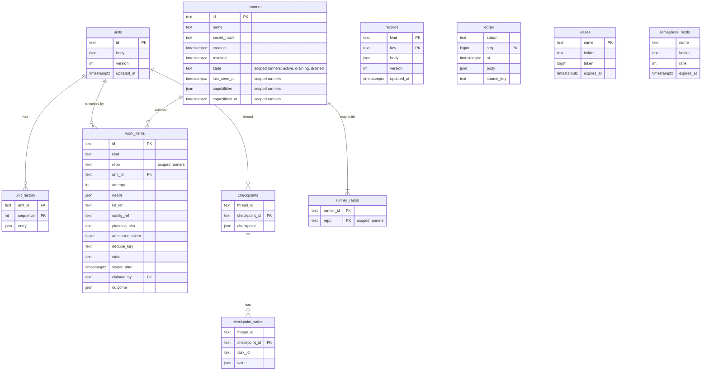

# One orchestrator, many workers: a local and a cloud deployment

The kit runs on one machine today. A timer starts `abk tick`, a dispatcher that starts an `abk worker build|resolve|verify`
process for each piece of work on the same host and exits ([worker-design.md](worker-design.md)). Every piece of coordination between them is a local file: `fcntl.flock` locks, pid-file
branch locks judged by the process start time and the host name, about twenty-five read-modify-write JSON stores and ten JSONL ledgers in `state_dir`, a SQLite
checkpointer and the locks in the machine's `local_dir`, and a wake file watched by a systemd path unit. The documents say one pipeline host is supported, and the capacity of a run is the capacity of that host.

This document describes one model for the pipeline with two deployments of it. The model is an **orchestrator** that decides what runs and **workers** that each
carry one piece of work, over a shared **store** and **queue**. There is always exactly one orchestrator, a long-lived primary that notices a new version of itself and hands over to it, draining what it started. A **local** deployment runs it on a machine the
installation owns, with workers on that machine or on other devices; a **cloud** deployment runs the orchestrator and the workers as cloud jobs over managed services. In both,
workers share nothing with the orchestrator but a network route to its worker API, through which they reach the store, the queue, the artifacts and the checkpoints, so a worker's placement is a choice, not a dependency. Each moving part is an interface with an implementation per deployment, the way a repository chooses its
forge today (`forges/base.py`, with a GitHub, an Azure DevOps and a local forge). The first cloud is Azure. It is a design, not a specification: paths and
function names are where the work happens today, and names for new things are proposals. Each [roadmap](#roadmap) item can become its own OpenSpec change.

## Goals and non-goals

**Goals**

- One model and one code path for scheduling, admission, building and landing, whichever deployment runs it, and as much of the same architecture as the two can share, even where that means a larger change to today's code.
- Exactly one orchestrator for an installation, in either deployment. Workers run on the orchestrator's device, on other devices or serverless in the cloud, with the same code and the same interfaces.
- An orchestrator that stays current: the primary senses a new version, starts it beside itself, hands the primary role over and drains, with no gap in scheduling and no unit lost.
- Workers that hold no database credential: they act through the orchestrator's worker API with a short-lived token for one work item.
- Capacity that is not one machine's: many workers at once, sized per job, with nothing shared on a local disk.
- Correctness that does not depend on a process being alive on a particular host: leases with fencing tokens instead of pid files, compare-and-swap writes instead of
  whole-file locks.
- A local deployment that keeps working at every step, on one laptop, with no cloud account (its PostgreSQL is a server the installation names, or one `abk db up` starts).
- A cloud deployment on Azure, with the interfaces written so another cloud is another set of implementations.
- Work that needs something only one machine has (a live stack, a deploy key, a subscription login) still runs, on a machine that has it.
- A repository is built only on the machines allowed to build it, and a machine sees nothing of a repository it is not allowed for: not its code, its plans, its tokens or its secrets. The orchestrator may run on a machine that is allowed for none of them (see [Scoped runners](#scoped-runners)).

**Non-goals**

- Rewriting the unit graph, the build steps, the review loop or the policy code. They call interfaces; they do not change.
- Several installations sharing one cloud deployment. One deployment serves one installation.
- More than one orchestrator for an installation. Capacity grows by adding workers, never rounds.
- A scheduler spread over several processes. The primary orchestrator is long-lived, which changes what [worker-design.md](worker-design.md) decided (a short round started by a schedule), but nothing else decides what runs.
- Moving the live stack of e2e tests into the cloud. E2E and deploy-and-test verification keep running where the stack is.

## The model

| Part | What it does |
|---|---|
| Orchestrator | The one primary, long-lived. It runs one round at a time in a loop (planning sync, gates, archive, readiness, admission and enqueueing, over what the stewards collected), serves the worker API, and hands over to a new version of itself. It polls the usage sources and no forge, and it holds no repository checkout and no repository credential. |
| Worker API | What a worker reaches the store, queue, artifacts and checkpoints through, with a short-lived token for one work item. The primary serves it. |
| Worker | Claims one work item (build, resolve or verify a unit, or steward a repository), runs it to its next wait, records the outcome and exits. |
| Runner | A host that claims work items of the repositories it is registered for, when it has the capabilities they need. A cloud job is a runner of one item; a machine running `abk runner` claims for its repositories, with its own `abk.runner.yaml`. |
| Store | The units, the records the pipeline keeps (plans, verdicts, pauses, snapshots, landing intents and the rest) and the ledgers, with versioned writes. |
| Coordination | Leases with fencing tokens and semaphores: the dispatcher, the branch of each unit, chat sessions, the e2e stack, the unit-test slots. |
| Queue | The work items the orchestrator admitted and the workers claim. |
| Artifacts | Failure bundles, transcripts and spec snapshots. |
| Secrets | Model keys, forge and push tokens, deploy credentials. A repository's are read on a runner allowed for it. |
| Model accounts | What a worker's agent runs on, and the budget or the usage window that bounds it. |
| Workspaces | The checkout a worker builds in. |
| Events | What starts a round sooner than the schedule: a worker that finished, a person's request. |

The rules that hold whatever the deployment:

- The orchestrator holds the **dispatcher lease** for its round. Its fencing token is written with every admission, so a round that lost its lease (a slow or
  suspended process) cannot admit on stale facts.
- The **primary lease** names the one orchestrator. A new version starts beside the running one and waits; the running primary notices it, stops admitting, drains and releases the lease, and the new one takes it and then the dispatcher lease for its next round (see [The orchestrator](#the-orchestrator)). Two versions never admit at once, because the primary lease and the dispatcher lease's fencing token both say so.
- A worker holds no database credential. It calls the worker API with the short-lived token it was launched with, scoped to its item's unit and group, and the API makes the same fenced writes the worker would otherwise make.
- A worker holds the **branch lease** of its unit while it runs and renews it with a heartbeat. Every store write it makes for the unit (the unit's row and the
  records it writes, such as verdicts) carries the lease's token, and the store refuses a write with a stale token. A worker that wakes from a suspend finds its
  token stale and runs its step again instead of recording a result.
- The token fences only the store. Effects outside it (a push, a pull request comment, model spend) are made safe to repeat instead: pushes use
  `--force-with-lease`, comments carry markers the kit already reads back, and spend is counted where it happened.
- Only a repository's steward polls its forge. Every other worker reads the outside world from snapshots in the store (`pipeline/snapshots.py`: `pr`, written by the
  repository's steward; `usage` and `pauses`, written by the orchestrator) and asks for a fresh one with `request_refresh`, as it does today.
- A runner claims only items of the repositories it is registered for, and the API refuses its token on any other repository's unit. The repositories are set by a
  person on the orchestrator, never by the runner (see [Scoped runners](#scoped-runners)).
- Workers never write the planning repository. They read the spec snapshot taken at admission, which holds only the item's change, and the configuration at the planning commit named in their work item,
  and a fix change a worker needs is a request record the orchestrator turns into a commit.
- A work item names the code and configuration it runs: `kit_ref` (the kit's commit in the worker's image or checkout), `config_ref` (the planning commit plus a digest
  of the machine overlay) and `planning_sha`. The merge-edge rule (`pipeline/units.py`, `merge_loaded`) admits a dependent of a kit merge once the code the workers
  run contains that merge.
- People act through intents: `requeue` and `approve` as today, and new unit `hold`, `release` and `prioritize` commands (today `hold` and `release` act on an e2e
  split, not a unit), write a record and an event, and the next round acts on them. Running ticks by hand to push a unit through is not needed.

## Three packages

The code is one repository and one uv workspace with three packages, so the orchestrator and the worker can be built, tested and shipped apart:

| Package | Holds | Ships in |
|---|---|---|
| core | What both sides import: configuration and installation, the model, redaction, telemetry, the interfaces below with their implementations, the unit store façade and shared types, the forges, the agent runtimes, the sandboxes, the toolchain profiles, the policy hooks and most of `pipeline/` (about 237 modules, 71,000 lines in the 2026-11-16 map) | every image and the CLI |
| orchestrator | The round: planning sync, collection, landing, gates, admission, the trackers' sync, status and `serve`, and the commands a person runs, including the `abk` entry point (about 95 modules, 34,000 lines) | the orchestrator's image, and the machine that runs `abk tick` |
| worker | A unit's graph, the resolution lane, verify and `abk worker` (10 modules, 6,300 lines); it grows when code only workers use moves out of the core | the worker image |

The import rules are checked by a source-scan test per package: the core imports neither of the others, the worker imports only the core, and the orchestrator imports
only the core and never the worker (and the worker never the orchestrator). A worker image therefore carries the worker and the core, and no round code. The worker API's server is in the orchestrator package and its client, the HTTP implementation of each interface, is in the core; a source-scan test keeps worker modules off the database layer. Which module
belongs to which package is the table in the design of `worker-stops-importing-the-orchestrator`, derived from an import map (module-level imports form a DAG; the only cycle comes from imports inside functions): seeds name each side, and anything a core module imports becomes core. All three install into one `agent_build_kit` namespace (PEP 420), so no import path changes. The map showed that today the worker reaches 231 of 342 modules through the dispatcher's module, so the split is preceded by a change that cuts the 13 imports between the worker's and the orchestrator's modules. The split happens before the store, coordination and queue interfaces land, so each of those is written once, in the core.

## Two deployments

`deployment.kind` in `abk.yaml` names the deployment: `local` (the default) or `azure`. Its settings that belong to one machine or one subscription (endpoints,
resource names, identities) go in `abk.local.yaml` or the secret store, never in committed configuration, the rule account directories follow today. A repository
keeps choosing its forge as it does now; the deployment does not change which forge a repository uses.

| | Local | Azure |
|---|---|---|
| Orchestrator | One primary `abk orchestrator` service that runs rounds in a loop, serves the worker API and hands over to a new version (`abk tick` stays as one round by hand), behind a Caddy proxy | One Container App, one replica, with ingress for the worker API; a new revision runs beside the old and takes over while the old drains. |
| Workers | Started through the Launcher on the orchestrator's device (`pipeline/spawn.py`: a transient systemd unit, else `Popen`, or a local container) or on another device (the same image on a remote container host, first through a Docker context); each reaches the store, queue, artifacts and checkpoints through the orchestrator's worker API | A manual Container Apps job: the orchestrator starts one execution per work item |
| Store, coordination, queue, checkpoints | PostgreSQL named by the `store.*` settings (`store.host`, `store.port`, `store.user`, `store.password`, `store.database`, or `ABK_STORE_*`, built into a URL by one SQLAlchemy builder) or by `store.url` / `ABK_STORE_URL`, in `abk.local.yaml` or the environment, on this device, on another device on the network or a managed server; `abk db up` starts a local container. Only the orchestrator connects to it; workers use the worker API. A SQLite file with the same schema is a test stand-in | Azure Database for PostgreSQL, the same schema and the same code, reached only by the orchestrator |
| Artifacts | Files under `state_dir` on the orchestrator's device; a worker on another device writes through the worker API | Azure Blob Storage |
| Secrets | The environment, `.env`, secret files, `gh` and `az` logins, SSH keys, on the runner allowed for the repository | Azure Key Vault through a managed identity, with a repository's secrets readable only by the identities of runners allowed for it |
| Model accounts | Subscription logins and API-key accounts, keys from the environment | API-key accounts only, keys from Key Vault |
| Workspaces | Clones on the worker's own disk | Partial clones on the job's disk |
| Events | A notification to the primary (in process, or a call to the worker API from a worker elsewhere) that starts the next round sooner | The same call to the worker API |
| Images | The kit checkout | Azure Container Registry |
| Telemetry | OTLP from every worker and the orchestrator to a Collector container, which writes the run logs | The same export to Azure Monitor (through the environment's OpenTelemetry agent or native ingestion; which signals each carries is to verify) |
| Sandbox | Landlock, as [sandbox-design.md](sandbox-design.md) describes | The container and its network as the boundary (see [Workers](#workers)) |

## Interfaces

Each interface is a Protocol under `agent_build_kit/orchestration/` with an implementation in `orchestration/local/` and one in `orchestration/azure/`, and a stand-in
for tests, the layout `forges/` already has. The Azure implementations need their SDKs, which are an optional extra (`agent-build-kit[azure]`), so a local install
needs nothing new. Every interface has a conformance suite that both implementations pass, in the change that adds the interface: locally, and for Azure against PostgreSQL and
Azurite in containers in CI. Telemetry, at the end of this section, is configuration of the existing export rather than a Protocol. These are the Protocols the orchestrator calls directly. A worker calls the same Protocols through an HTTP implementation in the core, which the worker API answers, so one interface has two transports.

### Store

- Units: `get(id) -> (unit, version)`, `list(filter)`, `put_if(id, unit, version, fence)`, `update(id, fn, fence)` (a compare-and-swap retry loop) and
  `append_history(id, entry)`. `UnitStore` (`pipeline/unit_store.py`) stays the façade with its domain methods; only its reads and writes move under it.
  `UnitStore.replace_if_unchanged` is already a compare-and-swap over a set of units (it writes the changed ones, removes some, and runs a callback while the store
  is locked); it becomes one transaction of `put_if`s and deletes that fails as a whole.
- Records, one kind per JSON store of today, named by area rather than file (`planned`, `verified`, `snapshots`, `prs` for `prs-<repo>.json`, `pauses` for the
  pause markers, `usage-cache`, `verdicts`, `audits`, `landing`, `e2e-held`, `tracker`, `notifications`, `tick`, and the rest): `get(kind, key)`,
  `put_if(kind, key, body, version, fence)`, `scan(kind)`.
- Ledgers, one stream per JSONL file of today (`usage-ledger`, `test-runs`, `flakes`, `decisions`, `admissions`, `product-defects`, and the rest): `append(stream,
  record)` and `read(stream, since)`.
- One implementation over SQLAlchemy Core (async), with PostgreSQL in both deployments, reached by a URL. A unit is a row with a version column, records of every kind share one table keyed by kind and key, a ledger stream is rows of one append-only table, and one schema with migrations serves both. A SQLite file with the same schema is a test stand-in and runs the same conformance
  suite; it is not the supported shape, because a worker on another device cannot open a file on the orchestrator's disk. SQLAlchemy removes the dialect differences in the schema and queries; it
  does not remove the differences that matter to coordination (`FOR UPDATE SKIP LOCKED` has no SQLite equivalent, so claims and leases are written as conditional updates both
  honour) or the need for a server a remote worker can reach.
- State is reachable from other devices: the orchestrator connects to the one store server, wherever it runs, and every worker reaches the store through the orchestrator's worker API, so a worker needs a route to the API and no database credential. This replaces the idea of putting the state directory on a network drive, which kept SQLite and the locks on local disk because neither is safe on a share.
- Worker access: the API's store routes are the Protocol's methods over HTTP, with the fence carried in the request; the API checks the token's expiry and scope (an item token's unit and group; a runner token's repositories against the repository of the unit a route addresses) before any read or write.
- The tables are in [The store's tables](#the-stores-tables).
- Today's files move into the store once, with `abk state import`.

### Coordination

- `acquire(name, holder, ttl) -> Lease{token}`, `renew(lease)`, `release(lease)`, `holder(name)`, and `semaphore(name, capacity)` with `acquire(holder, ttl, rank)`.
- Tokens only increase, and the store checks them on fenced writes.
- Two scopes. **Installation** scope is shared by every host: the dispatcher, each unit's branch, chat sessions, the e2e stack, the environment, per-account build
  places. **Host** scope is one machine's: the unit-test slots (they share that machine's CPUs).
- Both deployments: lease rows in the store (a conditional update on `expires_at` and the token sequence), and the host-scoped semaphores on the worker's machine. No
  separate lock service is needed.
- It replaces `workspaces.branch_lock`, `lease.Leases`, the slots of `pipeline/unit_test_slots.py`, `e2e.lock`, `environment.lock`, `dispatcher.lock` and the
  `.admission` lock, and with them the rule that a lock written by another host always counts as alive. The repository's `repo_turn` goes with the shared
  git directory it serves (see Workspaces).

### Queue

- `enqueue(item, dedupe_key)`, `claim(repos, capabilities, visibility) -> claim`, `heartbeat(claim) -> token, runner state`, `complete(claim, outcome)`, `abandon(claim, reason)`, `reclaim(item) -> claim`.
- A work item carries its kind (`build`, `resolve`, `verify`, `steward`), its repository, the unit (none for a steward item), the attempt, the capabilities it needs, `kit_ref`, `config_ref`, `planning_sha` and the
  admission's fencing token. The visibility timeout is what the `starting` marker (`STARTING_TTL`) is today.
- Both deployments: a queue table in the store, claimed with a conditional update (and `FOR UPDATE SKIP LOCKED` where the dialect has it). A managed queue is a later
  option, not a need.
- A worker the Launcher starts is handed its item and token. A runner that is not launched (`abk runner`) claims through the worker API with a token from its registration (see Secrets), and `claim` returns only items of the repositories that token carries, and nothing to a runner that is draining.
- An item handed back by a draining runner (`abandon(claim, reason=drain)`) is enqueued again at once and not counted. An item whose claim's visibility timeout lapses (its worker's heartbeats stopped) is recorded `lost`, naming the runner, and enqueued again with its attempt counted; after three `lost` attempts of the same item its unit is held for a person instead. `reclaim(item)` gives the runner that last held an item a new claim, lease and token, if nobody has claimed it since, and is not counted (see [Draining and lost runners](#draining-and-lost-runners)).

### Launcher

- `launch(item) -> handle`, `status(handle) -> running | exited(code) | unknown`, `cancel(handle)`, `capabilities()`.
- A container-based interface, so a worker's placement is a choice. Local: `pipeline/spawn.py` as today, or a container, on the orchestrator's device, and the same image on
  a remote container host for other devices, the first being a Docker context (a container engine's remote API over SSH or TLS). A Kubernetes Jobs implementation can be added without changing the interface. Azure: one execution of the manual worker job per item, started by the orchestrator; `status` comes from the job's execution and its exit code maps to a unit's
  state as a process's does today, for `reconcile_running` and `reclaim_stranded`.
- The Launcher starts a worker only where the item's repository is allowed: a launch target is registered like a runner, with its repositories.
- `launch` mints the item's token and passes it, the worker API's address and the telemetry endpoint to the worker's environment. The address is the proxy's (see [The orchestrator](#the-orchestrator)); a worker on another device trusts the proxy through its internal certificate authority, so `launch` also passes the authority's root certificate.

### Artifacts

- `put(key, data)`, `get(key)`, `list(prefix)` and a streaming `writer(key)` for a transcript while it runs. A unit's log lines are not an artifact: they are OTLP logs (see Telemetry). Redaction runs before a write, as it does for stored output
  today.
- Local: files under `state_dir`, where they are today; a worker elsewhere writes through the worker API, which writes there. Azure: Blob Storage, read through short-lived links by the CLI and the web UI.
- The `rr-cache` of each repository is an artifact kind: after a restack a worker uploads the entries it learned and downloads the merged cache on start, so a cloud workspace does not start empty. The orchestrator merges by conflict hash and keeps the most recently recorded resolution for a hash, and a person removes a bad one with a command.

### Checkpoints

- `open() -> BaseCheckpointSaver`, with the serialisation allowlist the checkpointer uses today.
- Both deployments: LangGraph's PostgreSQL saver on the store's server (the SQLite saver `graph/checkpointer.open_unit_graphs` opens today stays as the test stand-in). An Entra token used as the
  database password expires, so each new connection of the store's pool and of the saver's pool fetches a fresh one (to verify for the saver's pool). The branch lease keeps one writer per
  unit's thread.
- A worker uses a saver that calls the worker API, behind the item's token, and the orchestrator's side opens the PostgreSQL saver. Writing that saver is part of the worker API change, whose first task is a spike that proves it against how LangGraph uses a thread. The change stops there if it cannot, and the alternative is then local checkpoints written back to the API at each wait.

### Secrets

- `get(name)`, `env_for(names, ttl)`.
- A repository's secrets (its forge and push tokens, its `.env` and verify values, its deploy keys) are read on a runner allowed for it and never pass through the
  orchestrator, which holds only the store's credentials, the worker-token signing key and the model and usage credentials it uses itself.
- Local: the environment, `.env`, secret files at the paths the runner's `abk.runner.yaml` names, the `gh` and `az` logins and SSH keys, read on the runner. Azure: Key Vault
  through the job's managed identity, with a repository's secrets readable only by the identities of the runners allowed for it, and tokens that expire: a GitHub App installation token for GitHub (the App's private key is in Key Vault and the runner's
  identity mints the token), an Entra token for Azure DevOps (the identity is added to the organization as a licensed user), and a push over HTTPS with the token instead
  of an SSH key. These tokens last about an hour and a build can last longer, so a git credential helper fetches a fresh one during a run.
- The worker token: the orchestrator mints one per item, signed, naming the item, unit and group, and expiring within minutes. The heartbeat refreshes it, and it is refused once the item completes or the lease is lost. Its signing key is a secret only the orchestrator holds.
- Runner registration: a person registers a runner on the orchestrator with the repositories it may build (`abk runner register --repo <repo>...`), and the orchestrator prints a one-time registration secret and the proxy's root certificate. The runner stores both and exchanges the secret for short-lived tokens that carry its repositories, so it needs no launch. Runners can be listed, their repositories replaced (`abk runner update`) and revoked, and the store records which runner claimed each item.

### Model accounts

- An account has a kind. A `subscription` account is today's Claude Code login (`claude_account.py`, a config directory, the usage window and the usage guard in
  `pipeline/usage_guard.py`); it is local only. An `api_key` account names a secret, an endpoint (the Anthropic API, or Claude models on Microsoft Foundry), a budget
  per window and per unit, and a rate.
- `environment_for(account, step)`, `reading(account)`, `reserve(account, estimate)`, `settle(reservation, actual)`.
- An API key's budget is a soft limit. The orchestrator sums the spend of each account and window from the usage ledger (or from a gateway's figures,
  `pipeline/gateway_usage.py`) and publishes it as the reading the usage guard already reads (`runtimes/providers.ProviderReading` already models a budget in money).
  Admission stops starting units at the budget, and a per-unit cap is checked between agent steps. A rate-limit answer becomes a shared backoff snapshot.
- Local: subscription and API-key accounts, keys from the environment. Azure: API-key accounts only, keys from Key Vault, readings from the ledger.
- Endpoints: the Anthropic API is the first. Claude models on Microsoft Foundry are the second, with a project API key from Key Vault. Microsoft's documentation (read 2026-11-16) says that Claude Code runs against Foundry with `CLAUDE_CODE_USE_FOUNDRY`, `ANTHROPIC_FOUNDRY_RESOURCE` and a deployment name for each model role (Sonnet, Haiku, Opus), and authenticates with a project API key or with Entra through the Azure CLI; that `claude-sonnet-5-5` and `claude-opus-5-5` are generally available hosted on Azure; that client-executed tools and prompt caching are supported, web fetch needs an Anthropic-hosted deployment and the Files API is Anthropic-hosted only; and that Claude models deploy only in East US 2 and Sweden Central. Not verified: Entra through a managed identity (the documentation shows Azure CLI credentials only), and whether the kit's agent steps behave the same against Foundry. The first task of `model-accounts-have-kinds` is a live run of an agent step against a Foundry deployment.

### Workspaces

- `prepare(repo, base, branch) -> workspace`, `fetch(refs)`, `push(branch, force_with_lease)`, `dispose()`, `git_lock()`.
- Both deployments: a partial clone into the worker's own disk with a git directory of its own, so no refs, `rr-cache` or lock files are shared with the orchestrator or
  another worker, from an optional mirror. `git_lock` does nothing; correctness between hosts comes from `--force-with-lease` and the branch lease's token.
- A worker starts with the repository's merged `rr-cache` from the artifacts and keeps its own in the clone's git directory (see Artifacts).
- This retires today's local implementation, `git worktree add` on `repos.<name>.path` with the repository's `repo_turn` as `git_lock`: a worker on another device cannot
  share that git directory, and the shared directory is what the stale `rr-cache` lock and the worktree branch locks came from.

#### Save and restore

One routine, in one module of the worker package, lets a unit continue on another runner; a drain and a crash both use it.

**Save** runs at every step boundary of the unit's graph: after a step that committed (tests, implement, a fix, a rework), and after one that did not (review, checks, unit-test). It runs in a fixed order, so whatever is saved is consistent:

1. If the step committed, push the head to the unit's work-in-progress ref, `refs/abk/wip/<unit>`, with `--force-with-lease`. The tree is clean at a boundary. The push is the runner's, with the repository's credentials on that runner; the code never passes through the orchestrator.
2. Upload the agent session file as an artifact of the unit, redacted like a transcript, with its descriptor (below).
3. Write the checkpoint, naming the pushed head and the session artifact.

A checkpoint therefore never names a commit or a session the forge and the store do not have. The checkpoint is the unit's graph state (`UnitRun`, `pipeline/unit_state.py`), so it already carries what a next worker needs to continue: the review rounds and last findings, a person's comments and pending replies, the commits, the head and the verdict.

**Restore** is what every resuming worker runs, after a drain or a crash: read the latest checkpoint; fetch the work-in-progress ref and check out the recorded head; then check the session descriptor and, where it allows, download the session into this machine's account folder under this clone's path and continue it with `--resume`. Otherwise, or when the resume fails, the step runs in a new session, the path a session made under another account takes today (`graph/nodes.py`).

**The session descriptor.** Claude Code keeps a session as `<account config_dir>/projects/<the working directory, encoded>/<session id>.jsonl`, and the kit continues one with `claude --resume <id>` (`runtimes/claude_code.py`). The session's lines carry its id, its working directory, the Claude Code version and the owning account and organization ids (`ownerAccountUuid`, `ownerOrganizationUuid`); the login's `.claude.json` in the account's `config_dir` carries `oauthAccount.accountUuid` and `organizationUuid`. Save records the session id, the runtime, the owner account and organization ids, the Claude Code version and the clone-relative working directory; restore compares them with its own account before downloading anything:

- the same account and a Claude Code at least as new: download and resume;
- another account of the same organization: as the first task's spike decides;
- another organization, another runtime or an older Claude Code: a new session at once;
- a field missing: not resumable, a new session.

The descriptor keeps ids only, never the e-mail address or name the account file also holds. The session file's location and format are Claude Code's internals, not a published interface, so carrying a session is a runtime capability (a runtime declares whether it can export and import one; `claude_code` can, the others start a new session) and best effort. The change that builds this starts with a spike that moves a session between two configuration directories and two clone paths and resumes it under the same account, under another account of the same organization, and from a redacted copy.

**What each trigger loses.** A drain loses nothing: the worker finishes its step first. A crash loses the step that was running (the agent's uncommitted work in it, and any test or check run it was making), which runs again from its start on the next runner, unless the same machine comes back and reclaims it (see [Draining and lost runners](#draining-and-lost-runners)).

**Deferred: a save inside a step.** A periodic snapshot of a long agent step's dirty tree and session would let a crash resume mid-step. It is left out for now; because save and restore are one routine with a fixed order, it can be added as a second kind of save without changing restore's callers.

**Where the ref lives.** Whether Azure DevOps accepts a ref outside `refs/heads` is to verify; if not, the ref is a branch `abk-wip/<unit>` that CI triggers exclude. The settle-end branch check deletes it with the unit's branch.

### Events

- `notify(kind, key)`, `subscribe()`.
- The primary subscribes. In both deployments a worker elsewhere notifies through the worker API, the primary's own work notifies in process and a person's command writes an
  event record the primary reads; the primary then starts its next round sooner than its interval. Locally the wake file and its path unit (`pipeline/wake.py`) stay for a command
  on the orchestrator's device until the commands write intents (wave 3). Forge webhooks can feed it later.

### Telemetry (not a Protocol)

- Logs and traces are OpenTelemetry (OTLP), the same in both deployments. Every worker and the orchestrator export with resource attributes for the installation, the unit, the item, the worker
  and `kit_ref`, and redaction runs before export. The endpoint comes in the worker's environment, so a worker on another device exports over the network and writes no log file.
- Local: an OpenTelemetry Collector container, which an `abk` helper starts beside the database (or one the installation names), receives the export and writes the run logs the CLI reads;
  journald stays for the orchestrator's own service. Azure: Azure Monitor through the same export (which signals arrive is to verify).

## The orchestrator

A round is one function over the interfaces, the round `abk tick` runs today (`cli/pipeline.py`: `cmd_tick`, `_tick_with`, `_dispatch`). It keeps:

- the admission functions, which are already pure (`pipeline/occupancy.py`: `occupied`, `free`, `account_room`, `emergency_free`, `capacity`) and
  `pipeline/admission.admit`, reading live leases from coordination instead of pid files, with a capability filter in front;
- the rebuild budget (`REBUILD_BUDGET`, `REBUILD_WINDOW`);
- the snapshot server for usage and pauses, and the drift test that keeps the usage-endpoint functions out of a worker's entry point (the PR snapshots are written by the stewards, see below).

Verify runs as a worker kind (step 4 of [worker-design.md](worker-design.md), "Resolve and verify workers", in progress as the change
`worker-restack-verify-cutover` in the installation's planning repository), so a deploy that takes an hour no longer holds a round, and every round is short.
**What leaves the round.** Today's round reaches each repository's checkout and forge in about a dozen places, and each moves to the repository's steward, or to an item of its own when it is long:

| Today (`cli/pipeline.py` unless named) | What it does with the repository | Where it goes |
|---|---|---|
| `fetch_all`, `owed_units` (`pipeline/resolution_lane.py`) | `git fetch`; ancestry checks that decide which units are owed a restack | Steward: it fetches and records each owed unit in the store, which admission reads |
| `poll_all` with `Poller`, label refreshes and sweeps, retargets, closes and replies, tracker sync | PR listing, comments, labels, retargets | Steward: it writes the repository's PR snapshot and events |
| `land_units` (`pipeline/landing.py`) | `merge_pr` on the forge | Steward |
| `on_merged` handlers: `landing_check`, `_unit_head`, `fork_point`, `build_settled`, `ui_review` diffs | Recording a merge from git | Steward |
| `remove_merged_branches` (`pipeline/events.py`), `_close_hand_built` (`pipeline/external_done.py`), revert detection (`pipeline/review_revert.py`) | Branch removal, hand-merge and revert checks | Steward |
| `carry_held` (`pipeline/carry.py`) | Cherry-pick, push and a resolver model run, inline | A `resolve` item |
| The late check's `build_base_passes` (`pipeline/events.py`) | Runs the whole unit-test tier on the default branch, inline | A `verify`-like item on a runner allowed for the repository |
| `code_host` probing, `has_identity`, manual-step checks (`pipeline/manual_steps.py`), the archive's worktree sweep | `ls-remote`, `git config`, a check run in the checkout | Steward |
| `abk doctor` checks that read checkouts (false merges, changelogs, generated files and the rest) and `abk status`'s cassette reads | Reads of the checkout | Reported by the steward into the store; the commands read it |

The planner needs none of this: its model call sees the tasks text, the units in flight, the repositories' relationships from the configuration and the calibration ledger, with no worktree and no tools, and its one git read (which groups a started branch holds) becomes the built-groups record the build worker writes.

The primary runs rounds in a loop: after each it waits for its interval or an event, and it holds the dispatcher lease for each round. `abk tick` stays as a command that runs one round by hand
(for a test and for a person without the service), under the same lease. The primary also serves the worker API, which holds no scheduling logic.

**Staying current.** The primary knows its own `kit_ref` and senses a newer version in one of two ways. Locally a fetch-interval setting, off by default, makes it fetch the kit's main branch and compare it with its own `kit_ref` (a value such as `10m` turns it on); with it off, a person runs
`abk orchestrator switch`, which starts the new version beside the old one. In Azure a new image tag creates a new Container App revision. The new version starts beside it (locally a second instance of the service, in Azure the new revision's replica) and waits for the primary lease. The running primary then stops
admitting, finishes its round, releases the primary lease once the new one is serving the worker API, and exits when nothing it started is left to supervise. Running workers are not stopped: their
leases are rows in the store and the new primary's API answers their heartbeats at the same address. A new version that has not taken the primary lease within the takeover deadline (default 10 minutes, its own setting) is abandoned, the old primary keeps running and
a record says so. The merge-edge rule keeps its meaning: a dependent of a kit merge waits for the code that runs, now the primary's as well as the workers'.

**The API's address.** Locally a reverse proxy, a Caddy container that an `abk` helper starts, owns the worker API's address and forwards to whichever version is primary, so a switch changes the upstream and not the address. Its certificate comes from Caddy's internal
certificate authority, and the launcher passes the root to a worker on another device (and a registered runner receives it at registration). In Azure the Container App's ingress does this by revision.

`abk status`, `abk explain` and `abk serve` read through the interfaces, so they show the same thing for either deployment. The CLI talks to the deployment its
`abk.local.yaml` names. A hosted `abk serve` behind Entra sign-in is a later step.

## Workers

The worker's contract is the same in both deployments: claim an item, check its `kit_ref` and `config_ref`, take the branch lease, run the unit's graph to its next
wait from the checkpoint (`cli/worker.py` calling `cli/pipeline.build_unit` with `from_snapshot=True`), record the outcome, complete the item, notify, exit.

**The image.** It has Python 3.12 with the kit installed at `kit_ref` (the policy hook runs `sys.executable -m agent_build_kit.hooks.policy`), uv, git, node and npx
with the pinned OpenSpec CLI, the `claude` command, the allowlist proxy, and a layer per toolchain profile. Publishing a new image on each kit merge is what moves
`kit_ref` forward in the cloud. Locally the same entry point runs from the checkout or in a local container.

**What is injected per item.** The model account's environment, the forge and push tokens, the worker API's address and the item's token (no database credential), the item's id and the telemetry
endpoint. No account directory and no SSH key go into a cloud worker.

**The sandbox in a container.** Landlock needs the host kernel's Landlock module and syscalls that container runtimes may filter, and Azure does not document
either for Container Apps, so a cloud worker does not depend on it. The boundary is the container and its network: the agent runs as a separate unprivileged user
set in the image; the kit, its hooks and the agent's settings are owned by another user and not writable by it; and egress is limited by the environment's network
(a workload-profiles environment with a user-defined route through a firewall, or a network security group), with the kit's allowlist proxy as the list of allowed
hosts, since a process can ignore the proxy settings. Whether the root filesystem can be made read-only, which Container Apps may not expose, is to verify, and so is
Landlock on its runtime, which is added where it works. A new coverage value `container` describes this; where it ranks against `process` and `files`
(`sandboxes/base.py`, `Coverage` and `reaches()`) and which `sandbox.required` it satisfies is decided in the `worker-image` change. Locally the sandbox is Landlock
as today.

**Capabilities.** A runner advertises what it can do: the kinds it takes (`build`, `resolve`, `verify`, `steward`), `e2e:<dimension>`, `subscription:<account>`, and a size class. Admission matches
a work item's needs to them. `tests.e2e_available` becomes a runner's capabilities. Its repositories are not a capability: they are set on the orchestrator at registration, and a runner cannot advertise its way into one. A machine running `abk runner` claims the items of its repositories that it can run, whichever kind. It is not a daemon: a timer starts it for one claim pass, and it claims through the worker API; it reaches a forge only as a steward of one of its repositories.

**Worker kinds are modules.** In the worker package each kind is its own module (`build`, `resolve`, `verify`, `steward`), and what they share (claiming, the heartbeat and token refresh, the branch lease, reading the item's spec snapshot, recording an outcome) is a module of its own that every kind imports. A kind never imports another kind, and a boundary test holds that, as the package import rules are held.

**Resources.** A unit-test slot is host-scoped, so a cloud job has its own, and `tests.max_workers` follows the CPUs the job asked for. Package caches come from the
image or a cache volume.

## Scoped runners

A machine builds only the repositories a person allowed it to, and sees nothing of the others. The need that set this: a personal machine helps with the kit's units, and a company machine alone builds a company repository, for access and security reasons; the orchestrator may run on the personal machine.

**Two kinds of facts, two places.**

- **On the orchestrator, set at registration:** a runner's id, its secret's hash, and its repositories. They are the security boundary, so a person sets them on the orchestrator (`abk runner register --repo <repo>...`, `abk runner update`), at least one, each a repository the installation configures, with no wildcard. A runner cannot widen them. A runner's tokens carry them, `claim` returns only their items, and every route that addresses a unit refuses another repository's.
- **On the runner, in `abk.runner.yaml`:** everything about that machine. The runner reads it on each claim pass and sends the orchestrator only the capabilities derived from it (`subscription:<account>`, `e2e:<dimension>`, the kinds, a size class), never a path or a secret. `abk runner list` shows each runner's repositories and the capabilities it last advertised, with the time; a capability it stops advertising is gone on its next pass.

**Where the file lives.** `<config home>/abk/abk.runner.yaml`, which is `~/.config/abk/abk.runner.yaml` by default; the config home is the one the kit resolves for its timer units (`settings.config_home`: `XDG_CONFIG_HOME` or `ABK_CONFIG_HOME`). `ABK_RUNNER_CONFIG` or `abk runner --config PATH` names another file, for a second runner on one machine or a test. It is not beside `abk.yaml`, because a runner has no planning repository checkout (it reads spec snapshots), and not in a repository's checkout, which is a per-worker clone. It is never committed anywhere.

**What goes in it.** The shapes the configuration already uses, so the same loaders and validators read it:

```yaml
name: company-laptop                  # how `abk runner list` shows it; the id comes from registration
orchestrator:
  url: https://orchestrator.example:8443
  ca_cert: ~/.config/abk/runner/root.crt        # printed by `abk runner register`
  secret_file: ~/.config/abk/runner/secret      # the registration secret, mode 0600, never inline
accounts:                             # the shape of runtimes.claude_code.accounts
  work:
    kind: subscription
    config_dir: /path/to/.claude-work   # absolute, as account directories are today
repos:                                # where this machine keeps each repository's things, not who may build it
  company-repo:
    workspace_root: /path/to/abk-work/company-repo
    env:                              # the shape of verify.env: providers, values read here only
      SQL_CONNECTION_STRING: {from: env-file, file: /path/to/secrets/company.env, key: SQL_CONNECTION_STRING}
    deploy: {}                        # deploy commands and keys for verify, as a repository's deploy settings are today
tests:
  e2e_available: [azure-sql]          # becomes e2e:<dimension> capabilities
  unit_test_slots: 2
size: medium
kinds: [build, resolve, verify, steward]   # optional: the kinds this runner takes; all when left out
```

**Rules.**

- The file says where things are, not what the runner may do. A repository in the file that is not registered is ignored with a warning; a registered repository missing from the file is not claimed, because its secrets and workspace are not here, and `abk runner doctor` names it.
- No secret is inside the file. The registration secret is its own `0600` file, and repository values are read through providers (`env-file`, `yaml`, `command`), as `verify.env` is today.
- `abk runner init` writes a starter file with comments; `abk runner doctor` checks that the paths exist, every `config_dir` is absolute, the secret file is `0600`, the orchestrator answers with the given certificate, and the file's repositories match the registration.
- A runner on the orchestrator's own machine uses its own `abk.runner.yaml`, not `abk.local.yaml`, so the two roles stay apart. The keys about building that `abk.local.yaml` holds today (account `config_dir`s, `verify.env`, deploy settings) move into the runner's file when `hybrid-runner` lands; `abk.local.yaml` keeps the orchestrator's facts.

**The steward.** One `steward` item per repository and round (deduplicated), claimed by a runner allowed for the repository, does that repository's part of what the round does today (the table in [The orchestrator](#the-orchestrator)) and writes the results into the store: the PR snapshot, events, merges recorded, owed restacks, and the checkout facts `abk doctor` and `abk status` show. The round reads only the store, so it plans and admits a repository's units without its code or its credentials.

### Draining and lost runners

**States.** A runner is `active`, `draining` or `drained`, and revoked or not; the store keeps its `last_seen_at`, from its claim passes and its workers' heartbeats (`orchestrator-serves-a-worker-api` adds the columns and the commands; `workers-claim-work-items` adds what they do to claiming).

**Draining.** A runner leaves gracefully by draining:

- A person runs `abk runner drain <runner>` on the orchestrator, or the runner asks for itself (`abk runner drain` on that machine, through the worker API with its own token). A runner may only narrow what it does, so it may ask to drain and never to resume; `abk runner resume <runner>` is a person's, on the orchestrator.
- `claim` returns nothing to a draining runner, so its claim passes take no more work.
- Each of its workers learns of the drain from its heartbeat's answer, finishes the step it is in, saves (see [Save and restore](#save-and-restore)) and hands the item back with `abandon(claim, reason=drain)`. A running agent step is never interrupted; a step that ends with a dirty tree (the `parked_node` case) yields at the next clean boundary. A handed-back item is enqueued again at once for any runner allowed for its repository and is not counted as lost; the next worker continues from the checkpoint, with the review's findings, the comments and the commits it carries, and with the session where its descriptor allows.
- If no other runner is allowed for the repository, the item waits on the queue until one is, or until the drained runner is resumed; `abk runner list` and `abk status` show it waiting.
- When it holds no live claim it is `drained`: at most one step per running item after the drain began. A drained runner can be revoked, resumed or left as it is.
- There is no drain deadline. A person who cannot wait for the steps revokes the runner, and its items take the crash path.
- A planned shutdown of the machine is a drain, then the shutdown.

**A runner that crashes.** Nothing is asked of it; its leases say it is gone:

- Each worker heartbeats its claim and its unit's branch lease. When the heartbeats stop, the lease expires after its time to live and the claim's visibility timeout lapses; the round records the item `lost`, naming the runner, and enqueues it again at once for any runner allowed for the repository. This is what `reclaim_stranded` and `reconcile_running` decide today from pid locks on one host.
- The next worker restores from the last save, so the graph continues at the step after the last completed one; the step that was running runs again from its start.
- After three `lost` attempts of the same item the unit is held, naming the runners, instead of enqueued again (the rebuild budget's attempt counting). A lost steward item is not counted: it runs again in the next round.
- `abk runner list` shows a runner not seen for three heartbeat intervals as `unresponsive`. It is never revoked by the kit; a person revokes a machine that is gone for good, which refuses its tokens at once.
- Host-scoped semaphores (the unit-test slots) and installation leases (the e2e stack, the environment) expire with their time to live; item tokens expire within minutes.

**A runner that comes back.** A runner that restarts after a crash, and a worker that was cut off rather than dead and finds its heartbeat refused, check each item they held before claiming anything new:

- The runner keeps a small local record of its claims (the item, the unit, the clone's path), written when it claims and cleared when it completes or hands an item back.
- For each item in it, it asks the orchestrator what became of it:
  - **Picked up by another runner, or finished:** it stops. A worker process still running for it is stopped, its clone is deleted once its saved work is on the forge, and `abk runner doctor` lists any it could not check. Its unsaved work is dropped; the fence would refuse its writes (`StaleFence`) and `--force-with-lease` its pushes anyway.
  - **Back on the queue and not yet claimed:** it reclaims the item (`reclaim`), with a new claim, lease and fencing token, so any older token of its own is refused. The reclaim is not counted toward the three-loss hold.
  - **Still its own** (its lease never expired, after a short network drop, say): it carries on.
- A reclaimed item resumes from what the machine still has. If the clone is intact (its head is the checkpoint's or ahead of it, uncommitted changes included) and the session file is still in the account's folder, the step that was running resumes in that same session with one follow-up ("you were interrupted; the tree is as you left it; continue the step"), so the step is not lost. Otherwise it restores from the last save, as another runner would.
- Only then does it claim new work, unless it is draining.
- A crashed runner gets no head start: a lost item goes back on the queue at once, and the reclaim wins only while nobody has claimed it.

**What the store holds.** A repository's derived data (checkpoints with review findings, session artifacts, transcripts, failure bundles) may rest in the store the orchestrator serves; the repository's checkout and its credentials never do.

## The store's tables

The tables the planned changes add, in one schema migrated by Alembic. The change that adds each is on its line; a column or table marked *(scoped runners)* is added by this design, and the work item's columns beyond those the Queue section names are settled in `workers-claim-work-items`.



| Table | Added by | Notes |
|---|---|---|
| `units`, `unit_history` | `store-has-a-schema-and-units` (revision `0001_units`) | A unit's body is today's stored unit; the version is the compare-and-swap column. |
| `records` | `records-live-in-the-store` | One table for every record kind, keyed by kind and key, so a new kind needs no migration. Records and ledger rows name units, repositories and accounts inside their keys and bodies, not by foreign key. |
| `ledger` | `ledgers-live-in-the-store-and-state-imports` (revision `0003_ledger`) | Append-only; `seq` from the database; `source_key` makes `abk state import` idempotent. |
| `leases`, `semaphore_holds` | `coordination-has-leases-and-fencing` (revision `0004_coordination`) | Tokens from a per-name sequence; time is the database's. |
| `runners`, `runner_repos` | `orchestrator-serves-a-worker-api` (revision `0005_runners`) | `runner_repos` is the scoped-runner boundary; the capability columns come with `workers-claim-work-items` or `hybrid-runner`, which first record them. |
| `work_items` | `workers-claim-work-items` | Claimed by a conditional update; `repo` is what `claim` filters on. |
| `checkpoints`, `checkpoint_writes` | `store-has-a-schema-and-units` group 6 | LangGraph's PostgreSQL saver's own tables (shown in outline; the saver's setup creates them), one thread per unit. |

Artifacts (failure bundles, transcripts, spec snapshots, the `rr-cache`) are files or blobs, not tables.

## The planning repository

The orchestrator owns the planning repository: it keeps a clone and commits through the existing publish path (`planning.publish`). The tracking copies of a change's
`tasks.md` become store records, written into the repository when the change archives. `tracker.yaml` and `external.yaml` stay files people write, read and committed
by the orchestrator. A worker that needs a fix change (a flake, a failure on the base) writes a request record, and the orchestrator writes and commits the change.

## Today's state, and how it moves

| Today | In the model |
|---|---|
| `units.json` under one `flock`, rewritten whole | Unit rows with versions; `UnitStore.update(fn)` |
| About twenty-five JSON stores, most under a `flock`, a few with none | Record kinds with versioned writes |
| About ten JSONL ledgers, some trimmed in place | Append-only ledger streams |
| Branch locks, leases, slots, `e2e.lock`, `dispatcher.lock`, `.admission` | Coordination leases and semaphores with tokens |
| `starting` markers in `units.json` | The queue's visibility timeout |
| `reclaim_stranded` and `reconcile_running`, from pid locks on one host | Lease expiry and the item's `lost` outcome, with a hold after three losses; a returning runner's reclaim of an item nobody has claimed |
| Commits local until the push after review | A save at every step boundary: the head to a work-in-progress ref, the session to the artifacts, then the checkpoint |
| Failure bundles, transcripts, spec snapshots | Artifacts |
| Run logs | OTLP logs, through a Collector |
| `unit-graphs.sqlite` | Checkpoints |
| `runs/wake` and the path unit | Events |
| Worktrees sharing one git directory per repository | Workspaces (a clone per worker, in both deployments) |

`abk state import` moves an installation's files into the store once. After that the files are not written.

## Roadmap

Each wave ships the local and the Azure implementation together, each passing the interface's conformance suite in that wave. At every step a local install keeps working: a local implementation replaces the file-based code in
the same change that adds the interface.

**Wave 0** — `worker-restack-verify-cutover` (in flight): resolve and verify become worker kinds and the tick's thread pool is deleted.

**Wave 1a: the split** (before the store, so each interface is written once, in the core)

- `worker-stops-importing-the-orchestrator`: cuts the 13 imports between the worker's and the orchestrator's modules, with a boundary test whose baseline may only shrink.
- `kit-has-a-core-package`: the uv workspace and the core package, with the import-rule test.
- `kit-has-a-worker-package`: the worker's modules, `abk worker`, and the rule that the worker imports only the core.
- `kit-has-an-orchestrator-package`: the orchestrator's modules, and the rule that the orchestrator and the worker never import each other.

**Wave 1: the store, in both deployments**

- `deployment-selects-implementations`: `deployment.kind`, the registry of implementations, and `abk doctor` checks for each deployment.
- Three changes in place of `units-and-records-live-in-the-store`, each leaving a local install working:
  - `store-has-a-schema-and-units`: async SQLAlchemy Core, the schema and Alembic migrations, PostgreSQL and the SQLite stand-in, the units table, `UnitStore` as the façade with
    `update(fn)`, the store's server settings (`store.*` built into a URL by one SQLAlchemy builder, or `store.url`) and their `abk doctor` checks, `abk db up`, and the checkpoint saver on PostgreSQL.
  - `records-live-in-the-store`: the record kinds, one area per group.
  - `ledgers-live-in-the-store-and-state-imports`: the ledger streams, `abk state import`, and the files stop being written.
- `coordination-has-leases-and-fencing`: leases and semaphores in the store for every lock (the dispatcher and admission, a unit's branch, the e2e stack, the environment,
  and the unit-test slots as host-scoped semaphores), fenced writes, and a heartbeat that finds a stale token after a suspend and runs the step again.
- `artifacts-and-checkpoints-have-implementations`: files and Blob Storage; the SQLite and PostgreSQL savers.
- The async conversion, in order, beside the store changes: `blocking-io-has-async-forms` (async subprocess and HTTP runners), `the-worker-runs-on-an-event-loop`, `the-round-runs-on-an-event-loop` and `commands-and-serve-run-on-an-event-loop`, which deletes the transitional `run_store` bridge and holds the async rules kit-wide.

**Wave 2: workers from a queue, in both deployments**

- `orchestrator-serves-a-worker-api`: first a spike of the checkpoint saver over the API; then the `abk orchestrator` service with the worker API's store, artifact and checkpoint routes (the queue routes come with `workers-claim-work-items`), the HTTP implementation of each interface in the core,
  short-lived tokens scoped to an item, the Caddy proxy helper, runner registration with the runner's repositories (register, list, update, revoke) and tokens that carry them, and the rule that worker modules never import the database layer.
- `logs-and-traces-use-otlp`: OTLP export in the worker and the orchestrator, the Collector container and its helper, the local run-log sink, and the Azure Monitor sink.
- `launcher-runs-workers-over-a-docker-context`: the remote container host implementation of the Launcher.
- `workers-claim-work-items`: the work item with its repository, the queue table, a claim that returns only the runner's repositories, and the launcher with its process and Container Apps job implementations.
- `worker-image`: the image's contract, publishing to the registry on a kit merge, the separate user, the network egress limit with the proxy's allowlist, the
  `container` coverage value, and the telemetry resource attributes.
- `workspaces-have-a-clone-implementation`: clones for every worker, which retires the local worktree implementation.
- `rerere-cache-is-kept-as-an-artifact`: the per-repository `rr-cache` artifact, its merge by conflict hash, upload after a restack, download on start, and the command that removes a resolution.
- `secrets-have-implementations`: the environment and files locally, read on the runner allowed for the repository; Key Vault with a managed identity, a repository's secrets readable only by its runners' identities, and tokens that expire and are refreshed during a run,
  in the cloud.
- `model-accounts-have-kinds`: subscription and API-key accounts, the Anthropic API and Microsoft Foundry endpoints, budget readings from the ledger, a per-unit cap,
  a shared backoff. It is in this wave because a cloud worker needs an API-key account to run on.

**Wave 3: the orchestrator, in both deployments**

- `the-round-runs-over-the-interfaces`: events, admission under the dispatcher lease, capability matching; the round in a loop in the primary, locally and in the Container App.
- `orchestrator-switches-to-a-new-version`: the primary lease, sensing a newer version, starting it beside the running one, the handover and drain, the fetch-interval setting (off by default), `abk orchestrator switch`, and the takeover deadline (default 10 minutes) with its record.
- `the-orchestrator-owns-the-planning-repo`: tracking records, fix-change requests, the spec snapshot (the item's change only) and the planning commit for workers.
- `repo-duties-run-on-a-steward`: the `steward` kind and each of the round's repository steps (the table in [The orchestrator](#the-orchestrator)) moved into it, one area per group, with the late check and the carry as items of their own.
- `hybrid-runner`: `abk runner` with `abk.runner.yaml`, `abk runner init` and `abk runner doctor`, claiming any kind for its registered repositories; moved here from wave 4, because a local installation with machines of different access needs it and it needs no cloud.
- `cli-writes-intents`: requeue, approve, and new unit hold, release and prioritize, against either deployment.

**Wave 4: running on Azure**

- `azure-deployment-as-code`: Bicep for the database, the Container Apps environment (workload profiles, with the network egress limit) and its orchestrator app (one replica, ingress for the worker API) and manual
  worker job, the registry, Blob Storage, Key Vault, the managed identities and monitoring; `abk deploy azure` and its doctor checks.
- `two-host-conformance-suite`: races between two rounds and two runners against a real deployment, and the authentication paths Azurite does not cover (Blob
  user-delegation links, Entra sign-in to the database). The per-interface suites already run in each wave.

**Wave 5: operations**

- `budgets-alerts-and-spend-report`, `forge-webhooks-as-events`, `hosted-serve-with-entra-auth`.

**Changes not yet written, what each needs first and what it must include.** These are held until the change they need has a unit, so a spec never gets ahead of the code it builds on. Each also ships both deployments' implementations and its conformance suite.

| Change | Needs first | Must include |
|---|---|---|
| `workers-claim-work-items` | `orchestrator-serves-a-worker-api`, `coordination-has-leases-and-fencing`, and the async conversion through `the-round-runs-on-an-event-loop` | The Queue Protocol (`enqueue`, `claim` with the runner's repositories and a visibility timeout, `complete`, `fail`), which replaces the `starting` markers; a queue table; the work item (kind build, resolve, verify or steward, repository, unit, group, capabilities); the runner's last-advertised capabilities; a claim that returns nothing to a draining runner, the hand-back at the next step boundary (`abandon` with a drain reason, not counted) and the move to `drained` when it holds nothing; the `lost` outcome when a claim's visibility timeout lapses, its re-enqueue and the hold after three losses (replacing `reclaim_stranded` and `reconcile_running`); `reclaim` by the runner that last held an item nobody has claimed, and the runner's local claim record and check on return; the API's queue routes, completing the API change; the Launcher Protocol (`launch`, `status`, `cancel`, `capabilities`) with the process implementation and a manual Container Apps job (one execution per item); the item's token minted at launch |
| `worker-image` | `workers-claim-work-items` | The image contract, publishing to the registry on a kit merge, a separate user, egress through the proxy with an allowlist, `sandbox_coverage: container`, the telemetry resource attributes |
| `launcher-runs-workers-over-a-docker-context` | `workers-claim-work-items` (the Launcher interface) and `worker-image` | A Docker-context implementation (a remote engine over SSH or TLS): launch passes the token, the API address, the telemetry endpoint and the proxy's root certificate; status from the container's exit code; cancel; `abk doctor` checks for the context |
| `workspaces-have-a-clone-implementation` | `coordination-has-leases-and-fencing` and `kit-has-a-worker-package` | A clone with its own git directory for every worker in both deployments; retires the worktree implementation, the shared git directory, the worktree branch locks and `repo_turn`; the `dirty_worktree` hold keeps its meaning for a clone; save and restore (the save at every step boundary in its fixed order, the work-in-progress ref, the session artifact with its descriptor as a runtime capability, the restore rules and the fallback to a new session), starting with the session-moving spike; the check of whether Azure DevOps accepts `refs/abk/wip/<unit>` (else an `abk-wip/` branch CI excludes); a save inside a step stays deferred |
| `rerere-cache-is-kept-as-an-artifact` | `workspaces-have-a-clone-implementation` and the artifact routes of the API change | A per-repository `rr-cache` artifact; upload of new entries after a restack and download of the merged cache on start; the orchestrator's merge by conflict hash keeping the newest resolution; a command that removes a bad resolution |
| `secrets-have-implementations` | `orchestrator-serves-a-worker-api` | A repository's secrets read on a runner allowed for it, never through the orchestrator; the environment and files locally, at the paths `abk.runner.yaml` names; Key Vault with a managed identity in the cloud, per repository; tokens that expire and are refreshed during a run; forge tokens for the GitHub App and Entra service principal once decided (open question, before wave 4) |
| `model-accounts-have-kinds` | `secrets-have-implementations` | Subscription and API-key accounts; the Anthropic API first, then Foundry with a project API key from Key Vault; budget readings from the ledger; a per-unit cap checked between agent steps; a shared backoff; its first task is a live run of the kit's agent step against Foundry, and Entra with a managed identity stays unverified until then |
| `the-round-runs-over-the-interfaces` | `workers-claim-work-items` and the async conversion | Events, admission under the dispatcher lease, capability matching; the round in a loop in the primary, locally and in the Container App |
| `orchestrator-switches-to-a-new-version` | `the-round-runs-over-the-interfaces` and the Caddy proxy of the API change | The primary lease; sensing a newer version by the fetch-interval setting (off by default); `abk orchestrator switch`; starting the new version beside the old, the handover and drain; the takeover deadline (default 10 minutes) with its record of an abandoned takeover |
| `the-orchestrator-owns-the-planning-repo` | `the-round-runs-over-the-interfaces` | Tracking records (taking up `task-progress-is-tracked-in-the-state-home-and-archived-to-the-repo`), fix-change requests, the spec snapshot (holding only the item's change) and the planning commit for workers |
| `repo-duties-run-on-a-steward` | `the-round-runs-over-the-interfaces` and `workers-claim-work-items` | The `steward` kind in its own module; each repository step of the round moved into it, one area per group (fetch and owed restacks; the PR poll, labels, closes and replies; landing and merge recording; branch cleanup, hand-built closes and reverts; the checkout facts doctor and status show), each leaving a local install working; the late check and the carry as items of their own; the round reading only the store |
| `hybrid-runner` | `workers-claim-work-items` | `abk runner` as a timer-started claim pass; `abk.runner.yaml` (location, keys, loader), `abk runner init` and `abk runner doctor`; the move of the build keys out of `abk.local.yaml`; worker kinds as modules with a shared module and the boundary test; `abk runner drain` from the runner's machine; deleting the clones of items the runner no longer holds once their work is on the forge |
| `cli-writes-intents` | `the-round-runs-over-the-interfaces` | requeue, approve, and new unit hold, release and prioritize, against either deployment |
| Wave 4 and 5 changes | Waves 1 to 3 | As their roadmap lines say; the GitHub App and Entra decision comes before wave 4 and the budget decision before wave 5 |

The kit's own open changes `state-can-live-on-a-network-drive` and `task-progress-is-tracked-in-the-state-home-and-archived-to-the-repo` are taken up by this roadmap:
state reachable from other devices is the PostgreSQL store's job rather than a network drive's, and `store-has-a-schema-and-units` carries that as a requirement and archives the first when it merges; the
second becomes the tracking records of wave 3.

## Decisions

- One model, two deployments, chosen by `deployment.kind`; interfaces with an implementation per deployment, as forges have.
- Azure is the first cloud.
- PostgreSQL for the store, coordination, queue and checkpoints in both deployments, through SQLAlchemy Core, reached by a URL a local install supplies (`abk db up` is a convenience); a SQLite file is a test stand-in only.
- Exactly one orchestrator per installation. Workers share nothing with it and may run on its device, on other devices or serverless.
- The kit is three packages in one repository (core, orchestrator, worker), split before the store and coordination interfaces are written.
- The Launcher is a container-based interface of our own, with local, remote-host and Azure implementations; Kubernetes Jobs can be added later.
- Every worker works in its own clone; the shared-worktree implementation is retired.
- API-key accounts in the cloud; subscription logins stay a local account kind.
- A soft spend limit: admission stops at the budget, and a per-unit cap is checked between agent steps.
- The container and its network are the cloud sandbox; Landlock where the runtime allows it.
- E2E, verify and subscription-account work runs on a runner that has them (hybrid), and `abk runner` (wave 3) also claims any kind for its repositories.
- One long-lived primary orchestrator that senses a new version, starts it beside itself and drains; nothing else schedules. `abk runner` stays a timer-started claim pass.
- Workers reach the store, queue, artifacts and checkpoints only through the orchestrator's worker API, with short-lived tokens scoped to one work item; they hold no database credential.
- Logs and traces are OpenTelemetry (OTLP): a Collector locally, Azure Monitor in Azure.
- The first remote container host is a Docker context (a container engine's remote API over SSH or TLS).
- One installation per cloud deployment; the schema has no installation column.
- The worker API is fronted locally by a Caddy container with its own certificate authority, and in Azure by the Container App's ingress.
- A new version is sensed by a fetch-interval setting (off by default) or started by `abk orchestrator switch`; a takeover that has not completed in the deadline (default 10 minutes) is abandoned.
- A runner is registered once with a revocable secret and gets short-lived tokens.
- A runner is registered with the repositories it may build, set only on the orchestrator; its tokens carry them, its claims return only their items, and a route refuses another repository's unit. Repositories say nothing about runners.
- A runner's machine facts (accounts and their directories, workspace roots, secret paths, e2e availability, slots, size, kinds) are in its own `abk.runner.yaml` in the config home; it advertises capabilities derived from them, never paths or secrets.
- Each repository's forge collection, landing, merge recording and checkout work run in a `steward` item on a runner allowed for it; the orchestrator holds no repository checkout or credential, and the planner needs none.
- Each worker kind is its own module, with a shared module, and no kind imports another.
- A draining runner's workers hand their items back at their next step boundary and it claims no more; a person or the runner itself starts a drain, only a person ends one, and there is no drain deadline.
- One save routine, at every step boundary (the head to a work-in-progress ref, the session to the artifacts, then the checkpoint), serves drain and crash; a save inside a step is deferred.
- A crashed runner's items are enqueued again for any allowed runner when their leases expire and re-run the step that was running; after three losses of the same item the unit is held for a person. A runner that comes back reclaims an item nobody has claimed, and lets go of the rest.
- An agent session moves with its unit where its descriptor (account, organization, runtime, version) allows, and otherwise the step runs in a new session.
- A repository's derived data (checkpoints, findings, sessions, transcripts, bundles) may rest in the orchestrator's store; its checkout and credentials never do.
- The `rr-cache` of each repository is an artifact, merged by conflict hash with the newest resolution kept.
- Deploy keys stay on the machine that runs verify; verify and e2e run on a runner that holds them and is allowed for the repository.
- The Anthropic API is the first model endpoint; Foundry with a project API key is the second.
- The kit is async end to end: one event loop per process, owned by its entry point; the store, the worker API and the callers are `async def`. The synchronous callers cross one transitional bridge (`run_store`) until the four async-conversion changes remove it.
- The three packages share one `agent_build_kit` import namespace; migrations are Alembic's; the runtimes, sandboxes, profiles and hooks are in the core.
- The queue routes of the worker API are added by `workers-claim-work-items`, which owns the queue interface.

## Open questions

- Does Azure DevOps accept a pushed ref outside `refs/heads` (`refs/abk/wip/<unit>`)? If not, the work-in-progress ref is a branch `abk-wip/<unit>` that CI triggers exclude. To check before `workspaces-have-a-clone-implementation`.
- Is a GitHub App available for the repositories, and an Entra service principal for Azure DevOps, so every forge token expires? To be decided before wave 4.
- What are the default budget windows and caps, and who is told when one is reached? To be decided before wave 5; the model-accounts change only needs a budget to be configurable per account and window.
