# The unit graph

**Status: built.** The graph is the only engine. `graph/` holds the `UnitRun`
state, the node enum, the SQLite checkpointer with its allowlist and the
compiled graph, and `graph/unit.run_unit` runs a unit on it, over the
callables `wiring.build_runner` binds: `prepare`, `adapt`, `tests`,
`implement`, `stub_checks`, `fix_stub_checks`, `checks`, `fix_checks`, `review`, `rework`, `unit-test`, `e2e-test`,
`verify_base`, `new_comments`, `push`, `open_pr`, `await_review`, `satisfied`, `held` and
`failed`, joined by the edges below. Before a step that starts work or leaves
the machine the nodes consult `upstream_incomplete` and the hold, and a unit
whose base moved is held. `await_review` and `held` are interrupts: a unit
waiting in review or held waits there holding no branch lock and no slot.
`resume_unit` delivers an event to a thread as a resume command and stops,
leaving the thread at the node the event routes to. A usage refusal before an
agent step interrupts the thread, and a run killed mid-node is resumed at that
node. A tick drives each unit through `run_unit`: it starts the unit's thread,
or resumes one a killed or paused run left (a `running` unit that has a thread,
whose branch no live process holds). The poller's events and `abk requeue`
reach a unit that has a thread through `resume_unit`, which runs no node but
the wait; the tick runs the thread in a slot. A store that still holds in-run
progress from before the graph does not load (see Who holds what). One difference from the old runner: the `chore:` commit of
uncommitted work before each review round is not made, as every step already
ends in its own commit. This document is what the implementation is specified
against: it says which part of the pipeline moved onto
[LangGraph](https://docs.langchain.com/oss/python/langgraph/overview), which
part stayed as it was, and how the two meet.

## Why

A unit's lifecycle is a graph, and was written as hand-rolled control flow.
`UnitRunner.run` (`pipeline/stack_runner.py`) branched on a recorded step
(`resume_from`, since removed) and decided which steps to run next. `checkpoint()` and
`record_step` persisted where it got to. `reclaim_stale` put a unit back after
its process was killed. And a dozen event handlers in `pipeline/events.py`
reach into the unit store to send a unit back, hold it, or move it.

All of this is ordinary workflow engineering:

- durable steps;
- resuming after a crash;
- waiting days for a person;
- routing on a step's result.

LangGraph is a widely used open-source framework for exactly that. Moving the
lifecycle onto it is meant to buy four things:

- **Less custom orchestration.** The framework owns step order, checkpoints
  and resume, so we stop maintaining our own.
- **A lifecycle that reads as a graph.** The nodes and edges are the
  specification, and they can be drawn.
- **A framework others already know.** A contributor or an agent who knows
  LangGraph can read and change the lifecycle without learning a bespoke
  engine first.
- **Observability per step.** Each node is a span, steps stream as events,
  and the state of any unit's run can be inspected.

The agents themselves are unchanged. They are still external processes
reached through the `AgentRuntime` seam (`docs/agent-runtimes.md`). LangGraph
orchestrates around them and does not replace them.

## The boundary: what moves, what stays

The open-source framework (MIT, 1.2.x at the time of writing) covers the
lifecycle of one unit well:

- checkpointed state;
- [`interrupt()`](https://docs.langchain.com/oss/python/langgraph/interrupts)
  to wait for input, with no documented time limit, and
  `Command(resume=...)` to continue;
- [durability modes](https://reference.langchain.com/python/langgraph/types/Durability),
  of which `"sync"` writes every checkpoint before the next step;
- [retry and timeout policies](https://docs.langchain.com/oss/python/langgraph/fault-tolerance)
  on nodes;
- [custom stream events](https://docs.langchain.com/oss/python/langgraph/streaming).

What it does not cover is everything above a single unit:

- scheduling across runs;
- locks and resource limits;
- a scheduler, crons or webhooks.

Those belong to LangSmith's paid deployment
([agent server](https://docs.langchain.com/langsmith/agent-server),
[cron jobs](https://docs.langchain.com/langsmith/cron-jobs),
[double-texting](https://docs.langchain.com/langsmith/double-texting)). So the
line falls where a unit ends:

| Moves into the unit graph | Stays abk code |
|---|---|
| Step order and branching (`UnitRunner.run`) | Choosing what starts: `ready_units`, the depth caps, slot order, and `project_limits.max_units_in_progress` and `max_concurrent_stacks`, which are counted for each project (the limit on units in progress per account once an installation names a Claude account); before `prepare`, a ready unit is also checked against its own account's usage decision |
|  | Blocked units: a planned unit that `waiting_on` another unit is *blocked* (the graph's `blocked` label) and holds no place in `max_units_in_progress`; its ready, never-run prerequisite starts into that place ahead of the usual order, and a unit no longer blocked waits for room (`blocked`, `uncounted`, `ready_units`). A planned or unplanned unit parked on a split (`parked_on_split`) holds no place whatever its cause field says, a parked unplanned unit is left alone on release, and a replan keeps the park. A failed unit that waits on another unit holds no place either, is drawn `failed, waiting on <units>` and stays failed (`failed_waiting`); the pipeline requeues it once when its wait ends (see A failed unit whose wait ends). A planned unit that has never started and whose e2e-test split is held is not started and holds no place (see Held e2e-test splits) |
|  | `Needs:` dependencies, applied by `waiting_on`/`ready_units` like any dependency: a same-repo parent in review releases the dependent onto the parent's branch, a cross-repo one must merge. An edge is a merge edge (stored in `merge_needs`) when it crosses repositories, when the line says `merged`, or when its dependent is a failed unit waiting on the parent; it holds the dependent until the parent merged and a later tick has the merge. A failed or held unit requeued while its parent is unmet, or a `running` unit with a thread that no process holds while a merge edge of it is unmet, waits as `planned` with the cause `gated`. The graph draws a `Needs:` dependency as a thick edge, `==>|needs|`, a merge edge as `==>|needs, merge|` (the legend names both labels), and the planner's own as a plain arrow; the mark (`needs`) is recomputed from `tasks.md` each tick and affects no scheduling. A target the unit already reaches through its dependencies is recorded in `needs` but not linked, so it draws no edge |
| Where a run got to: the thread's position replaces `checkpoint()`, `record_step` and `resume_from` | The driver: the tick timer, `cmd_tick`, a pass's refresh loop |
| In-run state: review rounds, deferred follow-ups, pending replies and the comments they answer | Polling the forge (`pr_poller.py`): the source of events |
| Recovery after a kill: the tick resumes the thread | Branch locks, repo turns, the e2e-test lock |
| Waiting in review or held, and what `events.py` does to a waiting unit | Git and forge work: restack and adapt mechanics, the approved-commit push gate, the commit gate, the policy hook, forges, profiles |
| Stopping between steps for usage | The usage guard's decision (`usage_guard.py`), which a node asks |

A cause is standing or an event. The standing causes (`STANDING_CAUSES`) name a situation that lasts
until a state change passes another cause: `rework`, `base_changed`, `upstream_went_back`, `usage`,
`depth`, `toolchain`, `review_escalated_class`, `review_escalated_disagreement`, `needs_human`,
`reviewer_hold`, `gated`, `restack_conflict`, `restack_deferred`, `restack_handed_back`,
`dirty_worktree`, `attached`, `host_unavailable`, `network_unavailable`, `service_unavailable`,
`environment`, `split_held`, `manual_step` and `too_big_for_tier`. The event causes (`EVENT_CAUSES`) name a transition that is over:
`requeued`, `released`, `adopted`, `merged`, `auto_landed`, `closed`, `retired`, `superseded` and `failed`. An event cause ends
a standing one explicitly. A replan carries a standing cause through the demotion and the promotion
(and a vanished change and a join do the same), marking the entry `carried`, and a caller's state
change passes its own cause or none. `upsert` keeps a unit's runtime fields, so a gated or parked
unit stays parked across a replan. A record with no cause is one from before causes or one an event ended.

A unit over its tier's buffered ceiling is `held` with the cause `too_big_for_tier`, held by size
(`HeldBy.SIZE`), and waits for the split step. Once split it is `closed` with the cause `superseded`
and a `superseded_by` list naming its pieces (`<unit>-s1`, `<unit>-s2`, ...): it occupies no slot,
nothing waits on it (dependents are re-pointed to the last piece), and archiving counts it as
finished without merging. Its branch is kept under `refs/spec-driven/superseded/<unit id>`. When no
split can happen it is held again with `HeldBy.REVIEW` for a person.

A unit can also be `retired`, a state beside `merged` and `closed`: it is finished, builds nothing,
holds no place under `max_units_in_progress`, nothing waits on it, and no plan revives or reshapes it
(an upsert skips it, and the planner is shown its id as taken and refuses a plan that reuses it). Its
change archives only when every group it carried was built by a unit that merged or landed. A replan
also keeps a planned unit that has a branch, a pull request, a pushed commit or an approval when the
new plan leaves it out (`kept: <unit> has work; not in the plan`), and refuses, whole, a plan that gives
a group to a second unit while a started unit still carries it. `abk retire` is the one way a person
sets the state `retired`; `abk status` lists the units to retire.

### Who holds what

- **The graph page** draws one subgraph for each repo. A repo with several projects
  (those it declares and those of its units in view) nests one subgraph inside it for
  each project that has a unit in view, titled with the project's path and `.` for the
  root; a repo with one project is drawn flat, as before. An edge between two projects
  of one repo is plain, since it is within the repo.
- **`runs/units.json`** stays the scheduling record. It holds each unit's
  identity, change, repo, test kind (stored under the key `tier`), dependencies, state, branch, pull request and
  history. It is versioned beside the specs, the unit graph page is drawn from
  it, and `ready_units` reads it. What left it is in-run progress: where inside
  a unit a run got to, which is the thread's position, and the review rounds,
  deferred follow-ups, pending replies and the comments they answer, which are
  the thread's state. Two in-run fields stay, because something writes them
  with no run in progress: `approved` (the push gate and `build_restack` read
  and write it) and `predecessor_note` (`build_restack` writes it). A store that
  still carries a value in `review_rounds`, `deferred`, `pending_replies`,
  `person_comments`, `resume_from` or `classic_run` on a unit does not load: the error
  names the unit and the field, and that work must be finished or requeued first. The
  empty `resume_from` and `classic_run` the last release wrote on every unit are dropped
  on read.
- **The checkpoint** holds a run's progress. There is one LangGraph thread per
  unit, with `thread_id` equal to the unit id.
- **git** holds the work: every step that produces anything ends in a commit,
  as it does now.

One rule keeps these from drifting apart: **anything outside a running unit
changes that unit only by resuming its thread.** A merge that restacks a
child, a review comment, a requeue: each is a `Command(resume=...)` on the
unit's thread, which the graph routes like any other input. Nothing writes
into a waiting unit's state from the side.

The one thing that does run a thread outside a build worker is the restack lane: a unit told its
base moved is `running` with its thread parked at `prepare`, and the lane runs the whole moved-base run
(the move, the resolver, the port of a conflict, the checks and the review of the moved branch). The lane's cap
bounds the moved-base run; the run counts toward slot occupancy and is never held back by the limit on build
workers. It runs the thread to its next wait or end; only when the thread reaches a step outside a moved-base run (any work that is not about the move (a rework of other feedback, a fix of checks, the end-to-end tests, tests or implementation)) is the unit left `planned` with `restack_handed_back` at that step, for a build worker; a conflict left to the
unit's own run is `restack_conflict`. Each run the lane starts counts as one attempt at the tip of the
unit's base, together with the attempts made for a conflicting pull request; when the attempts at one
tip reach `global_limits.max_review_rounds` the unit is held for a person with a note naming the base,
the tip and how the last run ended, and a new tip starts the count again. Every agent call of a lane
run asks the usage guard first; a refusal defers the run, which the lane resumes once the guard allows,
as it does a run the process lost. The limits are counted for each project, not across all repos; once an installation names a Claude account, units in progress are counted for each account instead.
`max_concurrent_stacks` is always counted for each project, not for each account.

Before `prepare` (so with no worktree, branch or lease made), a ready unit is checked against its own
account's usage decision, made once for each account in a round. A refused unit waits with `usage_pause`
naming the account; the round-level any-account decision is only the early exit and the pause record.
A started unit (`running` with a branch) that a pause parks before its agent step still counts as in
progress for its account and shows as `paused` in the full-queue line.

## Priority

A unit carries a priority from 0 (emergency) to 5, 3 unless a `Priority:` line
says otherwise. It is the most urgent of the groups the unit builds and is kept
once the unit has started. A unit's effective priority is the most urgent among
itself and every unit that waits on it, directly or through a chain, in any
repo; merged, closed and satisfied units, and units the round leaves out, do not
count.

The planner is refused a plan that makes a unit wait on a less urgent unit that has not
started, unless the unit gives a reason in `needs_less_urgent`. An unstarted unit that a
more urgent unit waits on takes that unit's priority, and its record keeps the waiter in
`promoted_from`; both go back to the groups' own once the waiter merges or goes. A
started unit keeps its priority and its `promoted_from`. Plans recorded before this keep
their edges until `abk replan <change>` is run.

Within each class of start (open pull request, resumed build, never run) ready
units start by effective priority, then in the order they were planned; among units
that have never run, a handoff unit (one that takes the place a blocked unit frees)
breaks a tie of equal priority and goes ahead of the others, then effective age. Priority 0
starts first, and as soon as it is ready: it uses the project's emergency lane
(`project_limits.emergency_extra`) past the places and workers, and ordinary starts wait for it. `abk
status` lists the units whose priority is not 3 and the ready queue in that
order, each unit with its reason: `planned order`, `stack age, from <unit>` (it starts ahead of
older units because an older unit waits on it), its own priority, or the
priority it takes from the unit that waits on it, and marks a handoff unit `(handoff)`. For a project
whose emergency lane is in use it prints `emergency room N/M used by <units>`; a unit that
only the lane can start is marked `(emergency room)` in the queue, and a full-queue line adds that a
priority-0 unit may still start while the lane has room. The graph page adds
`priority N` to the node of a unit whose priority is not 3, with `promoted from <unit>`
(or `from <unit>` for a started unit a waiter covers) when that is where it came from.

## The graph

```mermaid
flowchart TD
    subgraph grp_ready[Get ready]
        prepare
        adapt
    end
    subgraph grp_build[Agent builds]
        tests
        implement
        rework
        fix_stub_checks
    end
    subgraph grp_quality[Quality checks]
        stub_checks
        checks
        fix_checks
        unit-test
        e2e-test
        review
        verify_base
    end
    subgraph grp_host[Human review and code host]
        new_comments
        push
        open_pr
        await_review
    end
    subgraph grp_stopped[Stopped or finished]
        held
        failed
        satisfied
        finished((end))
    end

    start((start)) --> prepare
    prepare -->|nothing of its own yet; also a part-built stubbed branch whose next group has no tests| tests
    prepare -->|part-built stubbed branch, next group's tests committed| implement
    prepare -->|stopped in the stub check loop| fix_stub_checks
    prepare -->|work on the branch| checks
    prepare -->|approved tip| verify_base
    prepare -->|the restack's two steps failed| adapt
    prepare -->|feedback waiting| rework
    prepare -->|approved commit pushed, pull request or replies owed| open_pr
    prepare -->|scheduled run| e2e-test
    adapt --> checks
    adapt --> rework
    adapt --> verify_base
    tests -->|not stubbed| implement
    tests -->|stubbed build| stub_checks
    stub_checks -->|fixers, then passed, commits the tests| implement
    stub_checks -->|passed, test-only group| tests
    stub_checks -->|test-only last group, commits| checks
    stub_checks -->|test-only last group, nothing new| unit-test
    stub_checks -->|failed, rounds left| fix_stub_checks
    stub_checks -->|failed, rounds spent or nothing changed, or a group has no pair| failed
    fix_stub_checks --> stub_checks
    implement -->|stubbed build, a group is left| tests
    implement -->|a group has no pair| failed
    implement -->|commits| checks
    implement -->|nothing new| unit-test
    checks -->|passed| review
    checks -->|failed, fix rounds left| fix_checks
    checks -->|failed, fix rounds spent| failed
    checks -->|e2e-test unit changes product code: scope guard| failed
    adapt -->|tests not accounted for| failed
    fix_checks --> checks
    review -->|approved, e2e-test unit| e2e-test
    review -->|approved, e2e-test deferred| verify_base
    review -->|approved| verify_base
    review -->|changes asked| rework
    review -->|needs a person, escalated| held
    implement -->|upstream went back, base moved| held
    fix_checks -->|upstream went back, base moved| held
    rework -->|upstream went back, base moved| held
    review -->|upstream went back, base moved| held
    e2e-test -->|upstream went back, base moved| held
    verify_base -->|upstream went back, base moved| held
    unit-test -->|upstream went back, base moved; on their conditions| held
    push -->|upstream went back, base moved; on their conditions| held
    review -->|rounds spent| push
    rework -->|commits| checks
    rework -->|nothing new| unit-test
    unit-test -->|passed, no commits of its own| satisfied
    unit-test -->|passed, after a clean move, e2e-test unit| e2e-test
    unit-test -->|passed, after a clean move| new_comments
    unit-test -->|passed, on its base| verify_base
    unit-test -->|failed| failed
    unit-test -->|failed or changed approval after a move| prepare
    prepare -->|approved tip, e2e-test unit| e2e-test
    e2e-test -->|passed| verify_base
    e2e-test -->|passed, scheduled run| satisfied
    e2e-test -->|passed, after a clean move| new_comments
    e2e-test -->|failed| failed
    e2e-test -->|failed after a move| prepare
    verify_base -->|base moved, clean| unit-test
    verify_base -->|base moved, conflicts| prepare
    verify_base -->|on its base| new_comments
    new_comments -->|new comments| rework
    new_comments -->|nothing new, or no pull request| push
    push -->|host moved the branch| held
    push --> open_pr
    open_pr -->|base gone| prepare
    open_pr -->|rounds spent| held
    open_pr --> await_review
    await_review -->|rework| rework
    await_review -->|base moved| prepare
    await_review -->|hold| held
    await_review -->|chat commit adopted| checks
    await_review -->|merged / closed| finished((end))
    held -->|requeue| prepare
    held -->|release| await_review
    held -->|chat commit adopted| checks
    held -->|merged / closed| finished
    satisfied --> finished
    failed -->|requeue| prepare

    classDef agent fill:#fde68a,stroke:#b45309,color:#1c1917
    classDef forge fill:#bfdbfe,stroke:#1d4ed8,color:#1c1917
    class tests,implement,fix_stub_checks,fix_checks,review,rework,adapt agent
    class push,open_pr,await_review,satisfied forge
    style grp_ready fill:#f5f5f4,stroke:#a8a29e
    style grp_build fill:#fffbeb,stroke:#d97706
    style grp_quality fill:#f0fdf4,stroke:#16a34a
    style grp_host fill:#eff6ff,stroke:#2563eb
    style grp_stopped fill:#fef2f2,stroke:#dc2626
    linkStyle 0,1,2,3,4,5,6,7,8,9,10,11,12,49 stroke:#9ca3af,stroke-width:2px
    linkStyle 13,14,18,19,21,22,41,42 stroke:#f59e0b,stroke-width:2px
    linkStyle 15,16,23,24,27,28,29,30,40,43,44,45,46,48,50,51,52,54,55,56,57 stroke:#22c55e,stroke-width:2px
    linkStyle 58,59,61,62,64,65,66,68,69 stroke:#3b82f6,stroke-width:2px
    linkStyle 70,71,72,73,74,75 stroke:#f87171,stroke-width:2px
    linkStyle 17,20,25,26,31,32,33,34,35,36,37,38,39,47,53,60,63,67 stroke:#ef4444,stroke-width:2px,stroke-dasharray:6 4
```

The boxes group the nodes by what they do: getting the branch ready, the agent's build steps, the quality checks (the pipeline's own checks and fix rounds, the unit-test and e2e-test runs, the agent review and the base check), the human review and code host (the pull request comments, the push, opening the pull request and waiting for a person), and the places a unit stops. A line takes the colour of the group it leaves (grey from getting ready, amber from the agent's builds, green from the quality checks, blue from the human review and code host, light red from the stopped group), and a dashed red line is one that puts the unit in `held` or `failed` from another group.

Amber nodes run an agent. Blue nodes are where the unit meets the code host,
and the runner does that itself, in code, without an agent. Unshaded nodes are
git, tests and bookkeeping. One node is not shaded but can call an agent: the
restack in `prepare` settles a conflict with the resolver's two steps (node
`restack`, in the build session). `verify_base` makes no agent call: a conflict
it finds goes back to `prepare`, which settles it in the same run.

The edges are the transitions the routers in `graph/` choose; their docstrings
are the reference for each condition. The nodes:

| Node | Does | Wraps (from `wiring.build_runner`) |
|---|---|---|
| `prepare` | Worktree, fetch, move the branch onto its base, settling a conflict with the restack's two resolver steps in the build session (hunks, then dependent files) and handing what they cannot settle to `adapt` (for a unit told its base moved, the restack lane runs this node and the nodes after it, and stops before any work that is not about the move (a rework of other feedback, a fix of checks, the end-to-end tests, tests or implementation)); picks the next node from what is on the branch and in state | worktree setup, `restack_onto`, `branch_commits` |
| `tests` | The tests-first commit (in a build with `builders.stubbed_tdd_commits` off, the fixers run, with no model call, before it). A stubbed build makes one pair per group: the tests are written here and committed only once `stub_checks` passes, each commit's body holding the change's Why sentence and the group's "Done when" | `run`, `commit` |
| `stub_checks` | Stubbed build only: runs the profile's fixers over the unit's own files (no model call), then, through the shared check-and-fix routine, lint, format and types over the stubs and tests, with no test run, then commits `test:` (a group with no new tests, in a unit that has commits, gets an empty `test:` commit marked `Already-built: yes` here); for a test-only group that commit is the group's last (a test-only group whose agent left nothing to commit is recorded, once the whole-repository unit tests pass, as a lone empty `test:` commit marked `Already-built: yes` that holds the agent's account) and the build goes past `implement` to the next group's `tests` or to `checks`. On failure it saves the output as `stub-checks` feedback and stops the unit once `global_limits.max_check_rounds` is spent | `run_stub_checks`, `commit` |
| `fix_stub_checks` | Through the shared check-and-fix routine: hands that output to the builder, stops if the round changed nothing (the fixers run before the next check, so a formatter's edit is not what fails it), then back to `stub_checks` | `run`, `tree_state` |
| `implement` | The implementation commit, after the fixers have run (no model call); a step that adds nothing is judged as any other, not against the usage window. A stubbed build makes one `feat:` per group, with the same body, and goes back to `tests` while a group is left; a group with no pair stops the unit, unless the branch holds no commit of its own, when the stubbed build also ends `unit-test` -> `satisfied` as the old one does; a group whose agents left nothing to commit, in a unit that has commits, is recorded as an empty `test:`/`feat:` pair marked `Already-built: yes`, with the agent's account in the `feat:` body, once the whole-repository unit tests pass; a group with no new tests then completes its pair with a real `feat:` commit or an empty one marked `Already-built: yes`, and real tests that already pass with no implementation change get an empty `feat:` commit, both once the whole-repository unit tests pass; a test-only group has no `implement` step | `run`, `commit`, `may_start` |
| `checks` | Through the shared check-and-fix routine, unit-test on the branch **before a reviewer is asked**, on the committed tree. Passing records the commit, so `unit-test` after approval is not repeated on it | `unit-test`, `commit` |
| `fix_checks` | Through the shared check-and-fix routine: hands the failed checks' output to the builder, runs the fixers (no model call) before the `fix:` commit, stops when the round changed nothing, bounded by `global_limits.max_check_rounds`, then back to `checks`. Records no reply, as there is no reviewer to answer | `run`, `commit`, `may_start` |
| `review` | One review round; records the verdict, findings, follow-ups and the approved commit. After a person's rework it is also given their comments, quoted, each with the builder's reply or `(no reply)` | `run_review` / `run_rework_review` |
| `rework` | Addresses review or forge feedback and records the builder's replies | `run`, `commit` |
| `adapt` | The last step of a conflict, after the restack's two resolver steps failed their checks: ports the old work onto the new base in the same session, told what was tried, and accounts for each test | the adapt agent, `check_test_decisions` |
| `unit-test`, `e2e-test` | The test kinds. `unit-test` is **not** run after a review: approval leaves the branch as `checks` judged it. It runs for a unit that produced nothing (judged on unit-test alone) and on a branch moved cleanly onto a new base, before the push. `e2e-test` follows approval for an e2e-test unit, unless its repo's `e2e_before_merge` is `deferred`: then the node is skipped after review, at an already approved tip and after a clean move (a scheduled run still runs it), and the unit's stored e2e state is `deferred` once its pull request opens | `unit-test`, `run_e2e` |
| `verify_base` | The fresh-base check before a push | fetch, `fresh_base`, `restack_onto` |
| `new_comments` | Before the push, for a rework of a unit with a pull request, reads the notes and conversation again; those not in `seen_comments` and not the pipeline's own go back to `rework` as feedback, restarting the round counters; `open_pr` records the ids given to the agent so the poller ignores them | `fetch_comments` |
| `push` | Pushes only the approved commit | the push gate, `push` |
| `open_pr` | Opens or updates the pull request, posts replies and the PR body | `open_pr`, replies, labels |
| `await_review` | **Interrupt.** Waits for the forge: rework, a merge, a close, a hold, a moved base | — |
| `held` | **Interrupt.** Waits for a person: requeue, release, merge, close. The store state the hold leaves (`held`, or `planned` for a unit held before a step) is recorded by the node that held, not by this one, which runs again from its start when resumed | — |
| `satisfied`, `failed` | Terminal for this thread; `failed` waits for a requeue. A satisfied unit's thread is deleted, its groups ticked and an open pull request closed with the reason | `close_pr` for satisfied |

Between steps a unit is held, not stopped: before `implement`, `fix_checks`,
`review`, `rework`, `e2e-test` (unless the branch just moved), `verify_base` (and
`unit-test` for a unit that produced nothing, and `push` when its rounds are spent)
the run asks whether its upstream went back for rework or its base moved or was
rewritten since `prepare` took the tip, and goes to `held` with the unit
`planned` if so. A step already begun is finished.

A base that moves before the push, a pull request refused for a missing base, a
failing unit-test or e2e-test after a clean move, and a move that changed what review
approved all go back to `prepare` once (`rebased`), so the restack resolves under
the usage gate and review reads the result; a second time the unit is held
`planned` for the next tick, so a base that keeps moving cannot loop.

### Who touches the code host

An agent never changes anything on the code host. The runner does all of it,
at fixed nodes, from the agent's *output*:

| Direction | What | Where | Done by |
|---|---|---|---|
| Read | New comments, review decisions, labels, check results, mergeability | the poller, which resumes `await_review` | the runner (`pr_poller`, the forge) |
| Read | The reviewer's own words, fetched when a rework is queued | `events.on_rework`, saved as the unit's feedback | the runner |
| Read | A failing check's log | the same, for a failing-checks rework | the runner |
| Read | Its own pull request (`gh pr view`/`diff`, `az repos pr show`: the forge's read commands, nothing that writes) | the review | the review agent |
| Into the agent | All of the above | placed in the `rework` / `fix_checks` prompt as text | the runner |
| Write | The branch | `push`, the approved commit only, with a lease | the runner |
| Write | The pull request: open or update, body, state labels | `open_pr` | the runner |
| Write | Replies to review comments | `open_pr`, from the JSON the rework agent ends with (`{"replies": [...]}`) | the runner, after the push |
| Write | Closing a pull request whose work already landed | `satisfied` | the runner |
| Never | Merge, vote, approve, the raw API | refused on every repo by the policy hook and the ACP deny list | nobody: the build agent never merges; a person merges what was not auto-landed |

So the agent hands back structured text and the runner posts it. The rework
prompt tells the agent not to post and to end with that JSON, so the replies
describe the code as the reviewer will see it once it is pushed.

What an agent *may* run is narrower than it looks, and deliberate. A build agent
is allowed its forge's read commands (`gh pr view` and `gh pr diff` on GitHub,
`az repos pr show` on Azure DevOps) and nothing else on the host; the review
agent has only `git diff`, `git log` and `git show`. The runner puts the
feedback an agent needs into its prompt, and the read commands are there for
whatever the prompt does not carry, so an agent may look at its own pull request
when it judges that useful.

The tracks (health, improve, recommend, propose) use the same freedom: their
prompts tell the agent to run `gh pr view <url> --json state` to see whether a
PR in a follow-up list has merged. That read stays with the agent. The line that
matters is the one in the table: agents read the host as they need to, and never
change it.

### Checks before review

Unit-test used to run once, after the reviewer approved, so a branch that did not
lint or type-check was reviewed twice over: once to approve it, and again after
the failure came back. The reviewer is also the more expensive model. Now every
route into `review` goes through `checks` first, including a rework: the
builder's fix for a reviewer's point can break the build as easily as the first
draft could.

A failure is saved on the unit as feedback (`unit-test failed:` and the output) and
goes to `fix_checks`, up to `global_limits.max_check_rounds` times (3 by default;
`null` is no limit; 0 means no fix attempt, not no check: it is the only gate
before a review and a push). The count is per round of review: `checks` runs at
the top of each round and the budget starts again, so a rework that breaks the
build gets its own attempts. A fix that leaves the branch unchanged ends the
run whatever the limit, as asking again would be the same question of the same
tree. The checks prompt tells the agent to run the checks itself to see output that is cut
short; for an e2e-test failure, which the agent cannot rerun, it names the file holding the full
output (unless it was withheld) and says the live tests cannot be rerun. Only when the
budget is spent does the unit go to `failed`, with the
output still saved, and `abk requeue --rework` is how it
gets another go with that output in front of the agent. A pause during a fix
keeps the saved failure, so the resume fixes what was found rather than finding
it again; a successful fix clears it, so a run stopped before its review does
not redo a fix that is already on the branch.

Nothing runs unit-test after the review. A reviewer reports and the builder fixes,
so approval leaves the branch exactly as `checks` judged it. The branch is
checked again only when it changes: a clean move onto a new base
(`verify_base` → `unit-test` → push) is checked before it is pushed, and a move with
conflicts goes through `adapt`, which accounts for its own tests and then back
through `checks` and `review`, since the resolution rewrote the commit that was
approved.

The nodes wrap the callables `wiring.build_runner` already builds. None of the
agent, git or forge logic is rewritten; what changes is who decides what runs
next. Node names are an enum, also used as the routers' return values, so a
misspelled edge fails when the graph is compiled, not in the middle of a run.

### State

The state is one pydantic model, `UnitRun`: the in-run progress that used to
sit in the unit store, plus what routing needs:

- **identity:** the unit id, its groups, its change. The id is `<change>/<lowest group>`, assigned
  by the program, not the planner; it is fixed at the first plan that contains the unit (a
  replan of an unstarted unit with the same groups keeps it, a join does not renumber it) and
  never changes once the unit has started;
- **progress:** the review rounds so far (each round's findings and the
  builder's response), the approved commit, deferred follow-ups, pending
  replies, the predecessor note;
- **step results routing reads:** commits this run produced, the last verdict,
  unit-test and e2e-test results, why a run stopped;
- **the last event received,** so a resumed node knows why it is running;
- **the running agent's session id,** written as soon as the runtime reports it
  and cleared when the node completes (see Session capture and resume);
- **what the build path routes on:** the base the unit is on once `verify_base`
  moved it, the commits on the branch when `prepare` finished, the branch's tip
  when the last node finished (what a re-run compares with), whether feedback
  was waiting at the start, the fix rounds and the review round so far, and
  whether the checks passed, the branch is empty or `verify_base` moved it, the
  base's tip when `prepare` began, whether it is an e2e-test unit, the restack that
  could not be merged (for `adapt`), whether the review rounds are spent, e2e-test's
  results, whether to go back to `prepare` and whether it already has once;
- **why a run is held:** the detail, the state the store is left in and its note;
- **how the run ended:** the status, detail and pull request `RunOutcome` reports.

Updates are partial: each node returns only the fields it changes. Anything a
person reads (state, pull request, history) is also written to `units.json`
by the node that changes it, as today. The graph diagram and `abk status`
keep working unchanged.

## Events become resume commands

The poller stays exactly what it is: snapshot, diff, report. What changes is
the handler. Today it rewrites the unit in the store. Instead it resumes the
unit's thread with a command:

| Event | Command | Routed by |
|---|---|---|
| A review asking for changes, a new comment, `agent-rework`, newly failing checks, a merge conflict (one that stands is moved again per base tip, and holds the unit when its attempts are spent or changed nothing) | `rework{reason, kind, feedback, source}` | `await_review` → `rework`; a merge conflict for a unit owed a moved-base run is routed to `prepare` with the conflict's feedback kept, and the rework runs only for what the move and the port leave |
| The parent merged, or the base was rewritten | `base_moved{new_base}` | `await_review` → `prepare` (a running unit sees it at its next node); the restack lane then runs the moved-base run from `prepare` for a unit left parked there |
| `agent-hold` | `hold` | → `held` |
| A commit adopted from a chat (see Chat in [architecture.md](architecture.md)) | `adopted` | `await_review` or `held` → `checks`; the review that follows is round zero and takes no place in the round limit |
| `agent-hold` removed | `release` | `held` → `await_review`, for a hold the label made |
| Merged | `merged` | → end; `units.json` records the merge, and a child waiting in review (stored `in_review`, within the rebase cap) is sent `base_moved{new_base}` and its PR is retargeted at once, instead of being restacked by the handler; every other child, with a thread or without, is handed to the restack lane to be restacked, or held for depth, or left alone |
| Closed unmerged | `closed` | → end |
| `abk requeue` | `requeue{mode}` | `held` / `failed` → `prepare`. `resume` (the default) goes back where it stopped; `restart` drops the saved failure and rounds but keeps the branch's commits (it does not start a fresh thread); `rework` keeps the work and the saved failure, and so enters at the agent with the failure in hand (`fix_checks` for a failed check) |

A delivery runs only the wait node's own work, the store writes and the event in
the state, and stops there (`interrupt_after` on the waits): it never runs the
next node. The unit is left `running` with its thread positioned at the routed
node (`rework` for a rework, `prepare` for a moved base, a requeue or the conflict of a unit owed a moved-base run), so
`resumable_units` offers it to the scheduler and the tick runs it in a slot like
any thread with work to do. The one exception is a moved base: a thread left at
`prepare` for it is run by the restack lane from `prepare`, with every agent call asked of the usage guard,
and runs the thread to its next wait or end; only when the thread reaches a step outside a moved-base run is the unit left `planned` with `restack_handed_back` at that step, for a worker. No other event handler, poll or `abk requeue` runs an agent, a
check or a push outside a slot, so `max_concurrent_stacks` holds for them.

An event for a unit whose thread is mid-node is kept and delivered once the
thread waits. A run holds the unit's branch lock from reading the thread's
position until it returns at a wait or the end (`build_graph`), and a delivery
holds it while it acts (`resume_unit`); there are no others, so a thread that is
mid-node always has its lock held, and the lock is what says a run is in
progress. `resume_unit` raises `BranchBusy`, with the thread untouched, when
someone else holds it. It raises it too when the thread has a node still to run,
because it was cut short, paused for usage, or already routed by an earlier
event: such a thread is not carried on inside the handler, the tick resumes it in
a slot, and the event is delivered once it waits. The event handlers and `abk
requeue` treat `BranchBusy` as the poller's deferral: the event is kept and the
poller reports it again. An event for a thread that has ended (`NotWaiting`) is
not delivered, and the handler does what the event handler acts on the store alone: it holds the unit
for a `hold`, saves the feedback and plans it again for a `rework`. `await_review`
and `held` are `interrupt()` calls, so a waiting thread's next node is the wait.
`merged` and `closed` route to the end and the thread is then deleted. A
`requeue` of a thread that ended in `failed` is delivered as if from `held`. A
`rework`, `hold` or `base_moved` for a held unit is not delivered: a person has it, and the poller keeps a comment unseen until the unit is released.
A merge sends `base_moved`, with the new base as its reason, only to a child
waiting in review (stored `in_review`, within the rebase cap), and that thread's
own `prepare` moves the branch while its PR is retargeted at once. Any other
child is handled by the handler itself, as above. If the delivery finds the child's
branch busy, the thread is not told and the handler logs that; the merge is not
redelivered.

A node that raises out of a run leaves its thread at that node while the build
records the unit `failed` (or `held`). Nothing will run that node, so a delivery
treats such a thread, with the lock held, as an ended one: a `requeue` positions it
at `prepare`, and any other event is `NotWaiting`, and the handler acts on the store as above.

## Durability and idempotency

- **Checkpointer:** `AsyncSqliteSaver` with WAL, in the state directory beside
  the unit store, and `durability="sync"`: the host can lose power at any
  moment. It is SQLite rather than a database server: one tick process writes
  it, with a handful of threads in flight, and a server would add the failure
  modes the pipeline exists to work through.
- **Serialisation:** an explicit `allowed_msgpack_modules` list for the state
  model's types, with strict msgpack otherwise. Checkpoint deserialisation has
  had remote-code-execution advisories (fixed in langgraph-checkpoint 4.1.1),
  and a type left off the list fails a resume, not a build. A test loads a
  checkpoint holding every state type.
- **A node killed partway re-runs from its start.** That is LangGraph's
  contract, and it is the same as today's step boundaries. So each node first
  checks git:
  - commits already on the branch from this step;
  - the pushed commit;
  - an open pull request.
  It does nothing twice: an agent node compares the branch's tip with the one
  its predecessor recorded, `push` always goes through the push wiring, where a branch the host moved is
  caught (pushing a commit the remote already has changes nothing), and
  `open_pr` runs again whole: the real call finds the branch's pull request and
  updates it instead of opening a second. A killed agent process leaves uncommitted work in the worktree; nothing
  commits it as `wip:`. Each agent node records its name in the thread state
  (`running_node`) before its agent starts and clears it when it completes, so a
  kill leaves it behind even when the runtime named no session. A dirty tree at
  the node named there, if it is one that edits (tests, implement, fix checks,
  rework, adapt; never review), with no live process on the branch, is that node's own:
  the re-run carries on over it. A recorded session is continued with the
  interruption prompt and nothing more; a new session (none recorded, or the
  runtime cannot continue it) is told in its prompt which paths are uncommitted
  work from an interrupted run, to be reviewed and finished. The node's commit
  includes them. Any other dirty tree (no record, another node's, a node that
  runs no agent, a hand edit) holds the unit with the cause `dirty_worktree`,
  the paths and a request to commit or remove them; nothing is cleaned, and
  `abk requeue` after the tree is clean resumes a park at an agent step at that step
  (`parked_node` in the thread state), with that node's inputs as they stood, a
  rework's feedback included; a park anywhere else, and `abk requeue --restart`,
  begin again at `prepare`. A requeue while the tree is still dirty leaves the unit
  parked. The dirty-tree rule reads the unit's chat lease first (see Chat in
  [architecture.md](architecture.md)): a lease whose server has gone while the lease is marked as
  holding changes means the files are a chat's, not a killed run's, so the unit is held
  with the cause `attached` and nothing is committed or continued, whatever
  `running_node` says; a lease held by a live process leaves the unit alone; a lease marked
  as holding a commit that was made and not delivered is a delivery to finish, not changes.
  Only with no lease at all does a recorded `running_node` make the tree the node's own.
- **A killed run is resumed, not requeued.** The thread's next node is the
  one that was running, and the next tick carries on from it with no new
  input. The unit stays `running`, and the tick resumes it unless a live
  process holds its branch. Nothing requeues it, and nothing commits what it left.
- **`review` and its rounds.** A round's findings are returned in the node's
  own update (`review_rounds` in the thread's state), not written to the unit
  store first, so a kill before the checkpoint leaves no half-recorded round: the
  re-run asks the reviewer again and records the round once. An approval is
  the exception: `weigh_review` records the approved commit on the unit
  (`approved`) as it is read, and a re-run records it again.
- **Timeouts kill the process group.** A node's `TimeoutPolicy` cancels its
  task, and cancelling a task does not stop a child process. The runtime call
  inside a node owns the agent's process group and kills it on cancellation.
- **Threads end when units do.** A thread is deleted when its unit merges, is
  closed or is satisfied. An unfinished unit is exactly a thread that still
  exists.

## The environment cause

Before a unit's unit-test runs (the `checks` node, or `unit-test` for a unit that produced
nothing), and again when a command the pipeline runs for unit-test fails, the pipeline runs
the planning environment's `check`. When it fails, the unit is `failed` with the cause
`environment`: no feedback is saved and no fix round runs. A unit's own failure while
`check` passes is an ordinary unit-test failure. The unit still counts toward the units in
progress, `abk status` and the full-queue line name it as waiting for the environment,
and a store whose only unit needing attention is failed this way still counts as work for
a tick. Each tick, once the environment is healthy, such units are resumed as `abk requeue`
resumes a unit, within the concurrency limits.

## A failed unit whose wait ends

Each round records, for a failed unit that waits on another unit, the units it waits on
(`waited_on`). When the wait is over and each of them is in review, merged or satisfied, the
pipeline requeues the unit once, through the delivery `abk requeue` uses, and clears the record, so a
wait is acted on once. `global_limits.wait_end_requeue` picks the mode. `auto` (the default) reworks a
unit with a saved unit-test or e2e-test failure and resumes any other (an environmental cause, no saved
failure, a review, CI or conflict failure); `resume` and `rework` force a mode (`rework` resumes a unit
with no saved failure and no note); `off` does nothing. A person's note is kept as guidance. A held
unit, a plain failure that never waited, and a unit whose prerequisite was closed or dropped from the
plan are left alone, and the last stays failed with `wait ended: <prerequisite> closed, requeue to retry`
in `abk status`. A prerequisite that is still open but whose `Needs:` line was dropped only clears the
record. `abk status` counts the units resumed this way today.

A unit that is `running` with a thread but held by no process (no branch lock, no lease) is checked
the same way before a round resumes it (`gate_resumable`): when a merge edge is unmet it is `planned`
with the cause `gated` and keeps its thread. The requeue above re-checks the unit's current
dependencies as it requeues, and `abk replan` prints `gated: <unit> waits for <dependency>` when a
new `Needs:` is unmet.

## Host outages

A step that gives up because the code host is unavailable (`HostUnavailable`) is not
a failure. The unit goes back to `planned` with the cause `host_unavailable`, the step
and the error text, and its thread stays at the node. The running pass readmits it
once its backoff has passed (1, 2, 5, 10, then 30 minutes by consecutive parking, from
when it was parked) and logs how long remains until then; a success resets the count.
Any other exception fails the unit and records its type, text and step.

An agent run that ends because the network or the model service is down parks the unit
the same way, with the cause `network_unavailable` or `service_unavailable`, on the same
backoff table. The runtime raises `NetworkUnavailable`. A strong sign (a name that cannot
be resolved, a network that is unreachable) parks it as `network_unavailable` on that
evidence. A weak sign (a refused or timed-out connection, "Can't reach the API server")
parks it by a connectivity probe, which makes no model call: the host the run called and a
control group (the code hosts and `global_limits.network_control_hosts`) are each looked up and
connected to. Both failing is `network_unavailable`; only the called host failing is
`service_unavailable`; the called host connecting, or a probe that errors, fails the unit.
No review, rework or check round is charged, a session the step was continuing is continued
on resume, and the unit keeps its place in `in_progress`. A run that ends on an HTTP status
of 500 to 599 raises `ServiceUnavailable` and parks the unit as `service_unavailable` on that
evidence, without the probe. Such parkings are counted in a row (`service_attempts`) and at
`global_limits.service_unavailable_attempts` (default 5) the next one fails the unit with its error
text and step; a completed step or a move to review starts the count again. Parkings the probe
sorted are neither counted nor capped. The status says `waiting for the
network` or `waiting for the model service`, beside `waiting for the code host`, and the
graph labels the unit the same way, with the step and the time it may run again. The probe
connects to the host the run called on the port it called, and to the control group on 443.

On a fresh start `prepare` notes whether the approved commit is the pushed head
(`pushed_head`) and whether a pull request exists (`opened`). With the former, and no
pull request or unposted replies (owed replies count only when no feedback is saved, so a
requeue for rework still reworks), `after_prepare` routes straight to `open_pr`, before
e2e-test, review or rework from saved feedback. Known limitation: a unit started fresh this way
has no e2e-test snapshot in its run state, so the pull request it opens lacks the e2e-test result
section.

## Manual steps

Declare a `Manual: <slug> — <what to do> — runbook: <path>#<heading>` line, with an optional
`Check: <command>`, for any step only a person can do. The runbook is prose for people, one
document per change with the step slugs as headings; the unit waits (`waiting for manual step`)
until the tick's check exits 0. `abk manual list` shows what is outstanding.

## When a step is e2e

An e2e step is one that needs a running service: a server, a database, a broker or `docker`.
An integration step is across modules of one package and needs nothing running. The sandbox
enforces the line: a unit-test or integration step is granted no localhost port, service port
or container socket, and an `[e2e-test]` step gets the repo's `tests.e2e_sandbox` lists. When a
unit-test run's output shows a refused loopback connection or service socket, its feedback says
a step that needs a running service is an e2e test and the group should be tagged `[e2e-test]`.

## Held e2e-test splits

A repo can hold one of its e2e-test splits for a reason (the hold, with its reason and until when, is
read from the state file and the configuration, never by asking a gate). A group names its split with a
`Split:` line and a unit records the one split its groups share, `rest` when they name none. Held
splits touch the graph in three places:

- **A run that reaches a held split parks.** When the tests of a held split did not run, `e2e-test`
  returns the unit to `planned` with the cause `split_held`, recording the splits, the commit the run
  passed on and the snapshot (`parked_splits`, `parked_sha`, `parked_snapshot`). Nothing is published and
  nothing counts against the unit, as those tests have not failed.
- **A parked unit is released when no split it waits on is held.** The round delivers it a `requeue`
  (resume), and `e2e-test` runs those splits alone when the branch is still at the commit it passed on.
  A parked unit whose group's `Split:` changed away from its park is the exception: it is reworked once
  with an automatic note (`RequeueReason.FROM_FAILURE`), its parked fields cleared and its stored split
  set to the new one, and while the new split is held it stays parked and the release of the old split
  does not resume it.
  A unit parked on a split holds no place under `max_units_in_progress` (`parked_on_split`), planned or
  unplanned; an unplanned one is left alone on release because the plan no longer has it.
- **A unit that has never started does not start while its split is held.** The round leaves it out
  as it does a held unit, so it takes no worker or place and lends no priority to what it waits on. Its
  wait reason is `split`, with the words `waiting for e2e-test split <name>: <hold>`. The promotion is
  worked out again each round, so the unit starts in the first round that finds the hold gone. A unit
  that has started is not gated, since nothing a hold could disturb is left to protect.
- **The graph draws it as blocked.** Its legend says a unit may wait on a held e2e-test split, and
  the `blocked` state's description does too.

## Usage pauses

Before an agent step (`tests`, `implement`, `fix_checks`, `review`, `rework`) a
node asks the usage guard. When the guard refuses,
the node interrupts with `{reason, until}`, `until` being the guard's resume
time (`UnitRunner.resume_at`); it does not put the unit back to `planned`: the
unit stays `running`, with its thread interrupted before the agent node, and
the run's outcome is `paused`. The tick resumes every thread interrupted that
way once the guard allows: it asks again on every tick, as the pause marker
does (`pipeline/pause.py`). The graph page draws such a unit as `running`. A step is never interrupted while it runs:
interrupts happen only at node boundaries.

### What pauses what

A pause is a marker in the state directory, kept per account as the usage cache is: `paused.json`
for the default account and `paused.<label>.json` for a named one, with the account on the record.
A rate limit (the model refused a build) or a usage refusal pauses its account, each on its own
marker and for its own reason (a round in which every open account refuses writes one for each).
Planning runs on the default account, so a rate limit on it holds planning too. Its units wait with
`usage_pause` naming the account and the time, while the units of every other account are admitted
and run. A round exits early only when every account with a unit that could start is paused. A
network outage is the whole installation's: it is one marker of its own (`network-paused.json`),
so no account's pause replaces it or is replaced by it, and it holds every
account. A `paused.json` written by an older version, with no account on it, is the default
account's (or the network's, when its kind is `network`). Each account's pause is cleared and logged once, when its own reading clears, and
`abk status` prints one pause line for each paused account (account, kind, end and reason).

### The admission records

Each admission of a never-started unit, each `slot` wait and each refusal by the unit's own
account (`usage`) writes a line to `admissions.jsonl` beside the decision log: the unit, the tick,
the slot (an account's label, or the project), the limit, the ids counted in the slot each with
its state and why it counts, the unit's own account's usage decision with its reading (source and
age, the threshold and the ceiling it ramps to, and whether the start was made on an estimate and
how many starts have been made on it), and a fingerprint of the merged configuration. The ids
counted are the units in progress and the units this round admitted before it, in start order. A
slot wait is written again only when the counted set or the limit changes. A tick that starts or
refuses a unit also writes each slot's ids, limit and room, after the round's starts. A unit its
account refuses at admission gets one `usage_pause` entry in its history, and one `usage` line,
for the episode, and one `usage_resume` when it is admitted again. An account no unit of came up
for a start in the round is recorded as not asked: the records never ask the guard. The file is
trimmed to `retention.decision_log_mb`, as the decision log is. `abk explain <unit>` reads these
back.

## Session capture and resume

An agent node, `review` included, passes `on_session` to the runtime, which
calls it once, on the init event that names the session, with the agent's
session id as soon as it knows it; the id is written into the thread's
state at once, so a node killed mid-agent leaves it behind. The node's
completion clears it. When the next tick re-runs a node that has one, the node
asks the runtime to continue that session with a prompt saying the process was
interrupted and to re-read the worktree before trusting its memory. A runtime
that cannot (`supports_session_resume` is false, or the session is gone or
refused: `SessionUnavailable`) is not an error: the node runs from its start in
a new session and says so in the run log.

A completed build node also leaves the role's latest session in the state: its
id, runtime, model, node, round and the branch's head when it ended, and
`build_model`, the model the first build node ran on. With `session_reuse` on
for the role (`build` by default), one resolution step before the agent call
chooses between the three ways a node can speak:

1. The node's own interrupted run (`session_id` set): continue it with the
   interruption prompt, as above.
2. The role's latest session, when the runtime that recorded it is the one
   running and can resume, and its recorded head is still readable in the
   worktree: continue it on the model it recorded, with the node's
   **continuation prompt**, which carries only what is new (the failure output,
   the review findings, the predecessor and the conflict) and drops the change
   path, task groups and boundary notes the session already holds. When the
   branch's head is not the recorded one, the prompt begins with the two hashes
   and an instruction to read what changed, never a log or a diff. After
   `adapt`'s reset the old work is under `refs/spec-driven/pre-adapt/<unit>`,
   which the prompt names.

   The prompt also says which of the change's spec files were edited since the
   session last ran. When a session is prompted, copies of the files it was
   pointed at are kept under `<state_dir>/spec-snapshots/<unit>/<role>/`: the
   unit's own groups of `tasks.md` (with the task boxes read as one form, since
   the pipeline ticks them itself), `design.md`, `proposal.md` and
   `specs/**/spec.md`, never `follow-ups.md`. A continuation whose files differ
   begins by naming each changed file and showing a diff, cut at 6000
   characters with a pointer to the files; a new session gets no notice. The
   copies are removed when the unit merges, closes or is satisfied.
3. Otherwise, or when the resume raises `SessionUnavailable` (including a
   context overflow, which Claude Code reports as a prompt too long): a new
   session with the full prompt on the node's model, and a line in the run log
   saying why.

`restack` (the resolver's calls in `prepare`) is a build-role node: with a
recorded build session it continues it, and with none it starts it on the rework
model, so a resumed unit's session may begin there. Otherwise `tests` starts the
build session. `implement`, `fix_checks`, `rework` (whether its feedback came
from a review round, failing checks or a comment on the pull request) and
`adapt` continue it, always on the model it recorded; so does the next build
node after `restack`.
`review` never continues a build session or an earlier review round's session:
its judgement does not share the author's context. The follow-up rounds of
`adapt`, which put its test accounting back to the agent, continue the session
the port ran in, and the session recorded for the build afterwards is always the
one that did the port. A node killed during a continuation resumes that session
on the model it recorded.
`fix_checks` starts a new session on `build_model` (the configured implement
model when none is recorded), and a continued session runs on the model it
recorded. A node that completes without
its call reporting a session, after one was started and killed, drops the
role's recorded session rather than keep one that no longer describes the
branch.

## Concurrency

- One tick process runs the threads on asyncio, at most `max_concurrent_stacks`
  executing at once in each project; the build pool holds every project's workers together. A thread waiting in an interrupt costs nothing.
- The scheduler is unchanged in what it decides. `ready_units` picks what
  starts, and existing work goes first. What it does changes: it **starts** a
  thread for a new unit and **resumes** threads that have something to do (an
  event, a usage pause that has cleared).
- A run holds the unit's branch lock from reading the thread's position until
  it returns at a wait or the end, and the nodes under it do not take it
  again: there is one lock mode, the run's. A thread waiting for review holds
  no lock, as its run has returned, so an event handler never finds the unit
  busy for days. A delivery takes the lock only for its own short write.
- Nothing but a slot runs a node. A poll's event delivery, `abk requeue` and
  the scheduler's refresh run no agent, check or push: they position the
  thread, and the pool runs it.
- Repo turns and the e2e-test lock are taken inside the nodes that need them, as
  the wrapped callables do now.

## Observability

- **A span per node,** with the unit id, change and step as attributes, and the
  round for the steps that go in rounds. It sits below the unit's span and the
  tick's, and agent spans nest under it; each node also records its duration
  and outcome (docs/architecture.md, Telemetry).
- **A span record per node** in the usage ledger: UTC start and end, duration,
  outcome and round, written when the node returns or raises. A usage pause
  (`usage_pause`) and the wait for a build slot (`slot`) are recorded as waits
  with their bucket, and each unit-test command with its duration
  (docs/architecture.md, Spans).
- **Progress lines** reach the unit's run log (`runs/unit-logs/`) through
  `RunLog.emit`, called by the nodes.
- **The graph itself** is the `Node` enum and the routers' targets in `graph/nodes.py`
  (`ROUTES`), checked when it compiles. The diagram above is written by hand from them, and the
  unit graph page of a planning repo draws the units, not these nodes.
- **LangSmith tracing** is supported by the framework, optional, and off by
  default. Nothing in the pipeline depends on it.

What stays in the store, and why: `approved`, because the push gate and
`build_restack` read and write it with no run in progress; `predecessor_note`,
because `build_restack` writes it the same way. `build_restack`
no longer writes a resume step: a restacked child goes `planned` with a note,
and its run's `prepare` decides from the branch. `in_progress` and the start
rank judge that a planned or unplanned unit has been started from what a run
writes: a recorded `branch`, a `pushed` or `approved` commit or a `pr`.

`UnitRunner`'s control flow, `checkpoint()`, `record_step` and `reclaim_stale`
are gone, and so is the `ABK_ENGINE` setting; it was never released, so it has
no deprecation window. The callables in `wiring.py` and everything they reach stay.

## Testing

- **Nodes** are tested alone with the same injected fakes the stack runner's
  tests use today.
- **Paths** are tested through the compiled graph. The stack runner's
  scenarios are ported one for one (build, review rounds, rework, adapt,
  satisfied, holds, spent rounds, moved bases, and the check before review:
  passing, fixed and re-checked, budget spent, no fix attempts, re-checked after a
  review rework, a clean and a conflicted move after approval), so the migration is checked against the behaviour it replaces.
- **Resume** tests:
  - kill the process mid-node and resume the thread in a new process, so that
    node re-runs and does nothing twice;
  - deliver an event to a thread that has waited across a restart, and one
    that arrives during a node;
  - a usage interrupt cleared by a later tick;
  - a node killed mid-agent resumes its recorded session, or falls back to a
    new one;
  - a checkpoint holding every state type loads under the allowlist.
- **Acceptance:** one real unit built end to end through the graph, reviewed,
  pushed, opened, then resumed by a real review comment. The live-agent tests
  read the run log as the graph writes it: lines are `<unit>: <node>: …` with
  the node names from `graph.state.Node`, and a failing e2e-test leaves the tail
  of its output there, under the `e2e-test` prefix.

## Open parents

A unit's open parents are its same-repo dependencies that are in review, looking through
satisfied ones. One is related to another when it is built on it, directly or through units
between; the unrelated open parents are those no other open parent builds on. A chain has one,
a diamond or siblings have several. A unit cannot run on two branches, so a planned unit that
has never started and has two or more of them is blocked: it builds on the one with the
greatest stack depth (a tie goes to the later in plan order, and a chain's newest whatever order
`depends_on` lists it in) and waits for the rest to merge or land (a closed parent still holds it, as any closed
dependency does). `abk status` says
`waiting for <change> group <n> to merge (second open parent)` and the graph draws it blocked. A started
unit keeps its branch and is never held by this rule. Cross-repo parents are not open parents
and still wait for a merge. No branch is made by merging parents' branches.

`abk tags` and `abk check` warn, without failing, for the groups that can produce such a unit.

## Dependencies

`langgraph` and `langgraph-checkpoint-sqlite` become core dependencies, pinned
together; the checkpoint packages have moved a major version within a year.
The framework brings `langchain-core`. Nothing else from LangChain is used:
there are no LangChain models, prompts or tools, since agents are reached
through `AgentRuntime`.

## Direct dependencies

A unit stores only its direct dependencies: `direct_dependencies` keeps the dependencies that
another of the unit's dependencies does not reach (one that another reaches is dropped), in the
order given. The walk follows stored edges through units of every state and repo, satisfied ones
included, and does not replace a satisfied unit by what it was built on, as `through_satisfied`
does. Every write (planning, a `Needs:` link, a join) stores the reduced list, and the graph
page, the unit's page, `abk status`, the pull request body and the planner show the same list. The
first tick or replan after an update reduces a store that lists more, once, through the store's own
methods.

An acceptance or narrow unit waits for every earlier unit of its change, computed at run time and
not from stored edges; that adds waits only, and its base, depth and open parents stay what its
stored dependencies give. Any other unit follows the chain: a unit sent back restacks its child, and
a unit in review follows its predecessor, with no wait on a grandparent. A `Needs:` the chain
implies is recorded in `needs` but draws no edge. A plain chain keeps two gaps: a deferred restack
leaves the units behind it where they are, and a thread that declines a move leaves its unit in review.

## Display statuses of a running unit

The store holds `running` for every unit an agent is working on. The graph, `abk status` and the
pull request's state label derive a finer name: `rebasing` when the unit was sent back for a
conflict, a moved base or a restack conflict or deferral, `reworking` when it is answering review
or check feedback, `paused` when a pause is in force and no run holds it (derived, never stored;
it resumes by itself when the pause lifts), and `running` otherwise. A pull request is a draft while its unit is `running`
or `planned` and ready when it is `in_review`.

## Why a unit is not running

A unit that is not running waits for one reason at a time (`WaitReason`), decided from the facts the
round starts units on. For a planned unit they are checked in this order:

| Reason | The unit |
|---|---|
| `lease` | has its lease held, as by an attached chat |
| `backoff` | is parked for the code host, the network or the model service, and its backoff has not passed |
| `blocked` | waits on other units (`waits_on`), on the release of a saved requeue, or on a stack deeper than the build cap; a unit held for depth reads the same |
| `split` | has never started and its e2e-test split is held |
| `usage_pause` | waits only because a usage pause is in force |
| `ready` | will be started this round |
| `queue_full` | has never started and its project has no room under `max_units_in_progress` |
| `slot` | is ready and waits for a free build worker |

A unit in review waits as `waiting_review`, and a held or failed one as `needs_person`. A reason is
logged to the decision log when it or what it waits on changes (architecture.md, State on disk).
A tick that builds nothing says why, and the first of these that applies is the account: a deadlock
(`nothing can start: deadlocked: …`); a project whose queue is full, which says that no ordinary unit
starts until the occupancy is below the limits (except a ready priority-0 unit while the lane has room);
a failed unit that holds others up (`nothing can start: <unit> has N units waiting on it — requeue it with
abk requeue`); and otherwise `nothing ready to build`, followed unless a usage pause is in force by a
line `<unit> (<label>): <reason>[, waits on <units>]` for each planned, held or failed unit, at most 10,
the ones a person can act on soonest (`ready`, `slot`, `lease`, `backoff`) first, then `(+M more)`.

## A unit in review follows its predecessor

In each round, after the fetch and poll, a unit in review whose same-repo predecessor's branch is changing is
set back to `planned` with the cause `upstream_went_back`, keeping its approval, branch and pull
request. A branch is changing when the predecessor is not in review, merged or satisfied and it
holds a commit beyond its last pushed head, is rebasing, or is itself planned for a changing
upstream or a moved base. A chain moves in one pass; a unit with a deferred restack or a restack
conflict is skipped while that cause stands, and one whose branch is busy is left for the next
pass. The move is delivered to the unit's thread as an `upstream_changed` event, the only event
kind that sets `planned`; the thread keeps waiting at `await_review`. When the predecessor is back in review the unit is
released and restacks onto its new head; an unchanged head restacks nothing.

A predecessor that builds nothing (`BUILDS_NOTHING`: `unplanned` or `retired`) is skipped here, by
the step-boundary check of a running build and by the rule that holds a returning unit for room:
the scheduler's wait ignores it, so none of them may put back a unit the scheduler admitted for
it, and a planned, running, failed, held or closed predecessor still holds its dependent with the
cause `upstream_went_back`. Each tick `link_needs` also drops a stored dependency on such a unit
that no `Needs:` line declares and logs `<unit>: dropped dependency <parent>: it builds nothing`;
a replan never changes a started unit's dependencies, so a group that moved to another unit would
otherwise leave the edge behind.

### How a bounce is counted

The store counts, where every state change is written, a unit that goes from `running` back to
`planned` or `held` after a run shorter than `global_limits.bounce_span_seconds` (default 120):
the same cause as the previous bounce raises `bounces`, another cause restarts it at one. A long
run, a write with no cause, review, failure, a finished state, or a person's `abk requeue` zeroes
it; a replan keeps it. At `global_limits.bounce_limit` (default 3) the tick logs `is looping`,
`abk status` lists the unit under `looping:` and the ready queue marks it `(looping)`. Nothing is
held or rescheduled because of it. Which paths put a unit back, and which protect themselves:

| Path | Cause | Protection |
|---|---|---|
| upstream guard | `upstream_went_back` | none |
| gated hold, second rebase hold | `base_changed` | none across ticks |
| restack deferred | `restack_deferred` | none |
| `reclaim_stranded`, no-thread fallbacks | `requeued`, `rework`, `released` | none |
| environment waiters | `environment` | none |
| host, network and model-service parks | `host_unavailable`, `network_unavailable`, `service_unavailable` | `PARK_BACKOFF`; `parked_attempts` fails the unit at a cap |

## The checking status

A unit stored as `in_review` reads `checking` while any check on its pull request is pending, or
while the pull request has none within `global_limits.checks_register_seconds` of the unit's last push
(`pushed_at`, written with `pushed`). It reads `in_review` once its checks have passed, or the window
has ended with none. The status is derived from the poller's snapshot (`prs-<repo>.json`), never
stored, and counts as in review for scheduling, queue places and dependents. `abk status`, the graph
and the pull request's state label show it, and the poll that records a pull request's checks moves
the label between `in-review` and `checking`. The web UI still shows the stored state.

## Cycles

Units that wait on each other never start, so no cycle is allowed to form and one that exists is
reported.

- **A planner edge is dropped.** After a plan is parsed and before it is stored, each dependency
  it proposes is tried against the units not finished: stored dependencies, the plan's own and
  the ones `Needs:` lines declare. One that would close a cycle is dropped from the plan and
  logged with the cycle; the rest of the plan stands. A replan clears such a stale edge from a
  unit that has not started and never changes the dependencies of one that has.
- **A `Needs:` edge is refused.** `link_needs` does not add a dependency that would close a cycle;
  the unit keeps its other dependencies, the refusal is logged, and `abk replan` exits non-zero.
  A tick logs it and carries on.
- **A `Needs:` cycle is an error before planning.** `abk tags` and `abk check` report a cycle
  formed by the `Needs:` lines of two or more changes and the order of each change's consecutive
  groups (an `Independent:` group has no edge to the one before), under each change that has a
  `Needs:` line on it.
- **A deadlock already stored is reported.** `abk status` lists each cycle of planned units that
  wait on each other once as `deadlocked:`, followed by the units and what waits on them; a pass
  that starts nothing says `nothing can start: deadlocked: …` ahead of any other reason. It is
  derived from the stored dependencies each time and nothing breaks it automatically: replan, or
  edit the `Needs:` line.

A unit a replan replaced (`unplanned`, or `retired` with its groups carried again) records the
units that carry its groups in `superseded_by`, left out of the stored record when empty. What a
unit depends on is read through it: a stored `depends_on` entry that names a replaced unit stands
for its successors, followed through further replaced units to eight links, once each and never the
unit itself; a replaced unit with no successors stands for itself and is treated as a parent that
builds nothing. Each tick `link_needs` rewrites a stored dependency on a replaced unit, in any unit
that has not finished, started or not, to its live successors (only those a `Needs:` line resolves to, when it names some),
refuses one that would close a cycle, and logs `<unit>: dependency <old> is now <new> (replaced
by a replan)`; units replaced before the field existed get theirs once, logged as `successors
recorded: <n> unit(s)`. A recorded wait (`waited_on`) follows the successor too.
